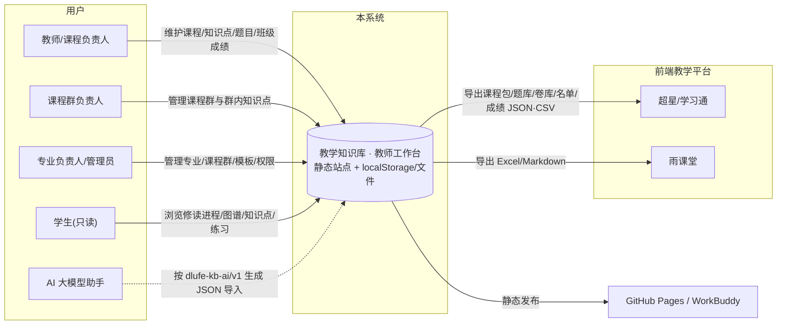
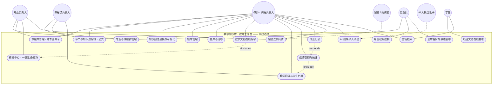

# 大连财经学院专业知识库系统 — 需求分析说明书

版本:v5.0 | 初版:2026-10-07 | 最近修订:2026-10-08(UML 全量审查与需求补齐) | 开发方法:UML 驱动 + HTML/JS 快速原型

---

## 1. 项目背景与定位

系统定位为**超星(学习通)、雨课堂等前端教学平台的"后端资源知识库"**。前端平台负责教学交互(签到、直播、讨论),本系统负责知识资源的**生产、组织、存储与导出**:

- 以「**专业 — 课程群 — 课程**」三级结构为主骨架;
- **课程为独立单位**,同一课程可被多个专业共享(如《数据库原理》同时服务于"大数据管理与应用"与"电子商务");
- 支持专业的新增与删减;
- 结合**知识图谱**与**静态网站**进行展示与发布;
- 可随时导出课程的大纲、教学日历、教案、知识图谱、章节知识点、题库、卷库、练习题、操作题等;
- 支持 **AI 生成结果**(如 DeepSeek/智谱/ChatGLM 产出的知识点、题目)的导入导出;
- 预留与**超星等教学平台的交互接口**(数据格式适配层)。

> **定位演进说明**:本系统最初定位为「专业知识库」,在第 3 次迭代中重新定位为**面向教师的「教学知识库 · 教师工作台」**(详见 `04-教师端重构方案.md`):不再只是超星的替代或附属,而是**超星教师端的后台与教学信息备份中心**。因此本文档在保留原始三级骨架需求的同时,补充了「教学班级」维度与「超星双向互动」要求。

## 2. 系统边界与角色



## 3. 用例图(UML Use Case)

> mermaid 无原生用例图,以下用 flowchart 近似表达:**双圆节点 = 参与者(Actor)**、**胶囊椭圆 = 用例(Use Case)**、**矩形框 = 系统边界**、**虚线箭头 = «include» / «extend»**、**实线 = 参与者—用例关联**。
> 注:节点标签中若含半角圆括号,必须用双引号包裹(如 `(["课程库管理(跨专业共享)"])`),否则 mermaid 解析器会把 `(` 当作形状起始符而整图渲染失败。



**用例说明(按角色)**

| 参与者 | 可操作用例 | 权限范围 |
|---|---|---|
| 教师 / 课程负责人 | UC02–UC07、UC09–UC13、UC15 | 本人负责课程可写,其余只读 |
| 专业负责人 | UC01、UC02、UC08、UC12 | 本专业及其课程群可写 |
| 课程群负责人 | UC01、UC03、UC09 | 本群课程及其知识点、班级可写 |
| 管理员 | UC01、UC16、UC17 | 全站可写,含角色与备份 |
| 学生 | UC14、UC15 | 全站只读(班级/成绩/超星模块不可见) |
| AI 大模型助手 | UC13 | 外部参与者,产出 JSON 经「数据与接口」导入 |
| 超星 / 雨课堂 | UC12 | 外部参与者,与本系统双向交换名单/成绩/图谱/题库/文档 |

## 4. 功能需求

| 编号 | 模块 | 需求描述 | 优先级 |
|---|---|---|---|
| FR-01 | 专业管理 | 新增专业(名称/代码/简介);删减专业(仅解除关联,不删除课程实体) | 高 |
| FR-02 | 课程群管理 | 每个专业下设多个课程群(如"数学与统计基础");课程群内挂接课程 | 高 |
| FR-03 | 课程库 | 课程为全局独立实体,含代码/学分/学时/课程目标;可被多个专业课程群共享;新增/编辑/删除 | 高 |
| FR-04 | 章节知识点 | 课程下按「章节 → 知识点」组织;知识点支持富文本(Markdown)、图片、**复杂 LaTeX 公式**、知识点间关联(边) | 高 |
| FR-05 | 知识图谱 | 知识点为节点、前置/关联关系为边;支持按课程/按专业过滤;力导向图可视化;可导出 JSON | 高 |
| FR-06 | 题库 | 题型:单选/多选/判断/填空/简答/**操作题**;字段:题干(含公式)、选项、答案、解析、难度、关联知识点;支持按课程/题型/难度筛选 | 高 |
| FR-07 | 卷库 | 从题库选题组卷,分大题(节)组织;自动统计分值;导出为 JSON/可打印 Markdown | 中 |
| FR-08 | 模板中心 | 预置模板:课程大纲、教学日历、教案、章节知识点讲义、练习卷;模板占位符自动填充课程数据;**模板可自定义扩展** | 高 |
| FR-09 | 导入导出 | 课程完整导出(课程+章节+知识点+图谱+题库)/导入;题库 CSV/JSON 导入导出;卷库 JSON;全库备份/恢复 | 高 |
| FR-10 | AI 接口 | 统一「AI 生成结果 JSON Schema」:AI 批量生成知识点/题目后一键导入;导出知识点清单供 AI 加工 | 高 |
| FR-11 | 平台接口 | 预留超星适配器:导出为超星课程目录结构/题库格式兼容 JSON;接口层抽象,后续可扩展雨课堂、学堂在线 | 高 |
| FR-12 | 统计看板 | 课程数量、知识点分布、题型分布等图表(ECharts) | 中 |
| FR-13 | 静态发布 | 纯静态站点(HTML+JS),可发布至 GitHub Pages 或 WorkBuddy;数据存于浏览器 localStorage + 文件导入导出 | 高 |
| FR-14 | 课程群体系 | 课程群为**独立实体**(与专业关联、设专人负责);专业直接关联课程并标注开课学期;群内课程按知识点跨课程衔接,覆盖低→高年级多学期 | 高 |
| FR-15 | 课程修读进程 | 专业下课程按学期升序呈现时间线,直观展示学生修读顺序 | 中 |
| FR-16 | 角色与权限 | 五类角色(管理员/专业负责人/课程群负责人/课程负责人/学生);模块可见性矩阵 + 数据范围校验(按钮级) | 高 |
| FR-17 | 教学班级 | 班级关联课程+学期+任课教师;学生名册(增删/批量/导入导出/搜索);成绩项(权重+满分)与加权总评;作业记录 | 高 |
| FR-18 | 成绩统计 | 班级平均/最高/最低/及格率/录入进度/分数段分布;成绩单导出与超星回填 | 高 |
| FR-19 | 教学文档中心 | 大纲/教案/教学日历/讲义**在线编写与编辑**(Markdown+实时预览+公式);版本快照与回滚;导出 MD/HTML、打印 PDF、导入回填;由模板生成落库、由文档反存为模板 | 高 |
| FR-20 | 超星双向互动 | 名单/成绩/作业/知识点目录/知识图谱/题库/教学文档包的双向导入导出;格式规范表;同步日志留存与追溯 | 高 |
| FR-21 | 教师任务工作台 | 按课程自动核查教学任务完成度(6 项)、进度条与待办提示、快捷入口 | 中 |
| FR-22 | 项目文档网页化 | 需求/设计/UML 过程文档站内在线阅读(Mermaid 在线渲染 UML);全文检索、页内目录、打印 | 中 |
| FR-23 | 全站检索 | 跨 专业/课程群/课程/知识点/题目/试卷/教学文档/班级 的统一搜索与分组结果 | 中 |

## 5. 非功能需求

| 类别 | 要求 |
|---|---|
| 界面 | 简洁优美、左侧导航 + 卡片式布局、浅色主题、适合高校教师高效使用 |
| 公式 | KaTeX 渲染 LaTeX,支持行内 `$...$` 与独立 `$$...$$` |
| 图表 | ECharts:知识图谱(力导向)、柱图、饼图、雷达图 |
| 可扩展 | 模板注册表、题型注册表、平台适配器均为可插拔结构,新增题型/模板/平台只需注册 |
| 数据安全 | 本地持久化(localStorage);一键全库备份/恢复 JSON;导出文件即离线副本 |
| 兼容 | 现代浏览器(Chrome/Edge),无需服务器,双击 index.html 亦可运行 |

## 6. 关键数据流(导入导出闭环)

```
教师编辑 ──┐
AI 生成(JSON) ──┤→ 【知识库核心库】→ 导出:课程包 / 大纲 MD / 教学日历 / 教案
Excel 题库(CSV)─┘                    → 导出:题库 / 卷库 / 练习题 / 操作题
                                     → 超星适配器 → 学习通课程目录 + 题库
```

## 7. 分期计划

| 批次 | 内容 |
|---|---|
| 第 1 批 | 需求 + UML 设计 + 核心系统实现(三级结构、章节知识点、知识图谱、题库卷库、模板、导入导出、超星接口预留)+ 发布 ✅ |
| 第 2 批 | 课程群体系(独立实体+负责人)、课程修读进程、五类角色权限 ✅ |
| 第 3 批 | 面向教师的重构:教学班级/成绩/作业、超星双向互动中心、教师任务工作台、界面精简与移动端 ✅ |
| 第 4 批 | 教学文档中心(在线编写/版本/打印)、项目文档网页化(Mermaid 渲染 UML)、各模块能力补齐(题库/卷库/模板/专业/排序/检索) ✅ |
| 第 5 批 | 全量 UML 审查与修正:修复用例图解析错误、类图/ER 图与 v4 代码对齐、补齐组件图/状态图/活动图/教师端用例图 ✅ |
| 后续 | 真实登录鉴权、超星开放平台 API 直连、成绩分析预警、GitHub Pages 同步发布 |
