# 大连财经学院专业知识库系统 — 系统设计说明书

版本:v5.0 | 初版:2026-10-07 | 最近修订:2026-10-08(UML 全量审查:类图/ER 与 v4 代码对齐,新增组件图/状态图/活动图)

---

## 1. 总体架构

```
┌───────────────────────────────────────────────────────────────┐
│ 表现层  index.html + css/style.css(单页应用,哈希路由)         │
│ 视图:教师工作台/专业/课程群工作台/课程库/教学文档/教学班级     │
│       /知识图谱/题库/卷库/超星互动/模板中心/全站检索/项目文档  │
│       /数据与接口                                              │
├───────────────────────────────────────────────────────────────┤
│ 视图层  views.js(核心视图)  views-teach.js(教师端视图)       │
│         documents.js(教学文档中心)  docspace.js(项目文档)     │
│         search.js(全站检索)                                   │
├───────────────────────────────────────────────────────────────┤
│ 服务层  store.js     数据持久化(localStorage)+ 权限矩阵       │
│         exporters.js 导出/导入/模板引擎/平台适配器            │
│         chaoxing.js  超星双向同步(CSV/JSON 适配)             │
│         render.js    Markdown + KaTeX 公式渲染                │
│         seed.js      示例数据(大数据管理与应用专业)           │
├───────────────────────────────────────────────────────────────┤
│ 图表层  ECharts(知识图谱/统计图) + KaTeX(公式) + mermaid(UML)│
├───────────────────────────────────────────────────────────────┤
│ 数据层  localStorage(运行时,KEY=dlufe-kb-v4) + JSON/CSV 文件 │
│ 构建层  tools/build-docs.js(文档网页化) tools/validate-uml.mjs│
│ 发布层  GitHub Pages / WorkBuddy 静态托管                     │
└───────────────────────────────────────────────────────────────┘
```

## 2. 核心类图(UML Class Diagram)

> 本类图与 `js/store.js`(实体定义)、`js/exporters.js`(适配器/模板注册表)、`js/seed.js`(数据顶层键)逐一对应。

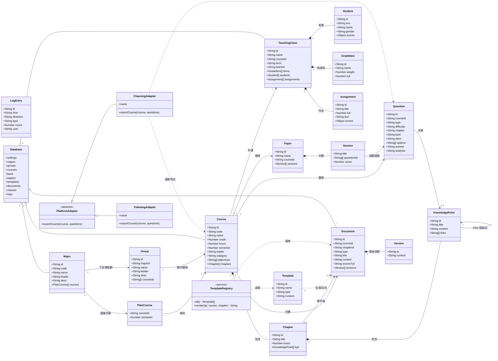

> 关键设计:
> 1. **课程为全局独立实体**:专业通过 `PlanCourse{courseId, semester}` 关联课程(可跨专业、且各专业开课学期可不同);课程群通过 `courseIds` 引用同一课程实体 → 实现跨专业共享。删除专业仅删引用,课程实体保留。
> 2. **群 ↔ 课程为多对多关联**(非组合):`Group "1" --> "*" Course`。
> 3. **知识图谱由数据派生**:`KnowledgePoint.links` 自关联形成图谱边(可跨课程),无需独立图谱实体。
> 4. **平台适配器可插拔**:`ChaoxingAdapter` / `YuketangAdapter` 均继承 `PlatformAdapter`,经 `PLATFORMS` 注册表按 key 取用。

## 3. 数据模型(ER)

```mermaid
erDiagram
  MAJOR ||--o{ PLAN_COURSE : "开课计划(含学期)"
  PLAN_COURSE }o--|| COURSE : "指向"
  MAJOR ||--o{ GROUP : "下设"
  GROUP }o--o{ COURSE : "群内课程"
  COURSE ||--o{ CHAPTER : "包含"
  CHAPTER ||--o{ KP : "包含"
  KP }o--o{ KP : "图谱关联边"
  COURSE ||--o{ QUESTION : "题库"
  QUESTION }o--o| KP : "关联知识点"
  COURSE ||--o{ PAPER : "卷库"
  PAPER ||--o{ SECTION : "大题"
  SECTION }o--o{ QUESTION : "选题组卷"
  COURSE ||--o{ CLASS : "开课班级"
  CLASS ||--o{ STUDENT : "名册"
  CLASS ||--o{ GRADE_ITEM : "成绩项"
  CLASS ||--o{ ASSIGNMENT : "作业"
  STUDENT ||--o{ SCORE : "得分"
  GRADE_ITEM ||--o{ SCORE : "被评"
  COURSE ||--o{ DOCUMENT : "归属文档"
  CHAPTER o|--o{ DOCUMENT : "章节级文档"
  DOCUMENT ||--o{ DOC_VERSION : "版本快照"
  TEMPLATE o|..o{ DOCUMENT : "生成/反存"
  LOG {
    string id
    string time
    string direction
    string type
    number count
    string user
  }
  SCORE {
    string studentId
    string itemId
    number value
  }
```

> 说明:实体与 `store.db` 顶层键一一对应 —— `majors / groups / courses / bank(QUESTION) / papers / templates / documents / classes / logs`。
> `SCORE` 由 `Student.scores{itemId: value}` 与 `Assignment.scores{studentId: value}` 拆解建模,便于表达"学生×成绩项"的多对多评分关系。

## 4. 关键时序图

### 4.1 课程导出 → 超星平台适配包

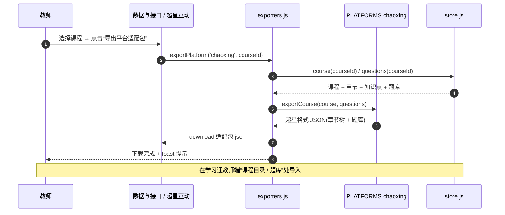

### 4.2 AI 生成结果导入

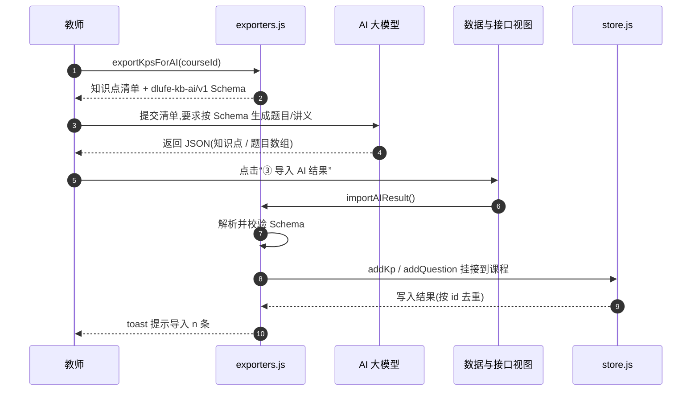

### 4.3 超星双向同步:成绩回填

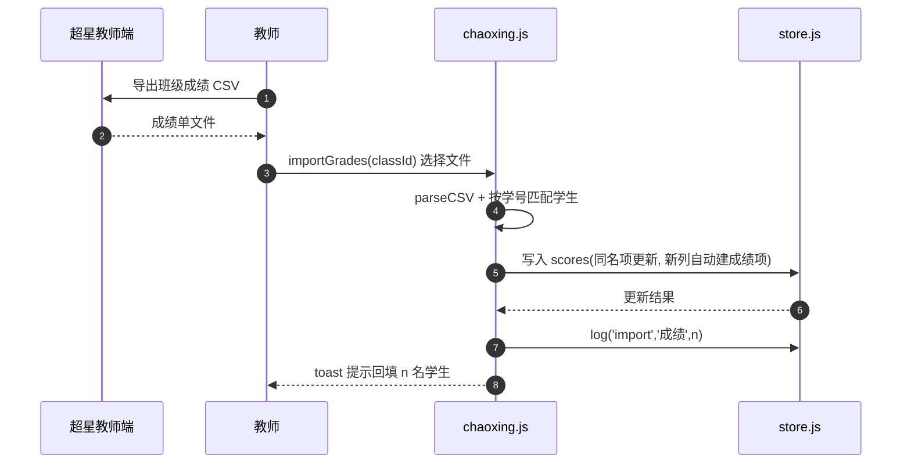

## 5. AI 生成结果 JSON Schema(v1)

```json
{
  "schema": "dlufe-kb-ai/v1",
  "courseCode": "BX211001",
  "kps": [
    { "chapterTitle": "第3章 函数与模块", "title": "递归函数", "content": "Markdown,可含 $f(n)=f(n-1)+f(n-2)$" }
  ],
  "questions": [
    { "type": "single", "difficulty": "中", "chapterTitle": "第3章 函数与模块",
      "kp": "递归函数", "stem": "…", "options": ["A. …","B. …","C. …","D. …"],
      "answer": "A", "analysis": "…" }
  ]
}
```

## 6. 模板引擎设计

模板为带占位符的 Markdown 文本,注册于 `TemplateRegistry`:

| 模板 ID | 名称 | 主要占位符 |
|---|---|---|
| tpl-syllabus | 课程教学大纲 | `{{course.name}}` `{{course.objectives}}` `{{chapters}}` |
| tpl-calendar | 教学日历 | `{{calendar.rows}}` 周次×章节×学时 |
| tpl-lesson | 教案 | `{{chapter}}` `{{kpList}}` `{{course.name}}` |
| tpl-exercise | 练习题集 | `{{bank.rows}}` |
| tpl-handout | 章节知识点讲义 | `{{kp.contents}}` |

新增模板 = 在模板注册表中追加一条 `{id,name,content}`,零代码改动页面逻辑。

## 7. 题型注册表(可扩展)

`single 单选 / multi 多选 / judge 判断 / blank 填空 / short 简答 / op 操作题`
新增题型:向 `TYPES` 注册 `{id,label,hasOptions}` 即可,视图与导出自动感知。

## 8. 知识图谱设计

- 节点 = 知识点(按章节着色,大小=关联度);边 = `kp.links`(前置/关联);
- 课程维度:单课程图谱;专业维度:跨课程按 `courseId::kpId` 全局图谱;
- 渲染:ECharts `graph` force 布局;导出:`{nodes, edges}` JSON,可直接供 Gephi/Neo4j 二次分析。

## 9. 部署图

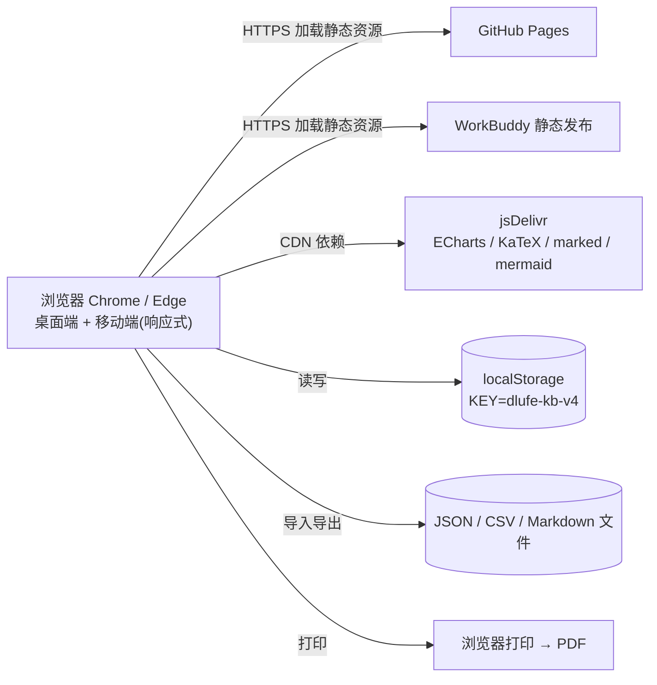

## 10. 目录结构

```
knowledge-base/
├── index.html              入口(单页应用;按依赖顺序加载 17 个脚本;第三方库全本地化)
├── css/style.css           界面样式(含移动端响应式与打印样式)
├── libs/                   第三方库(本地化,不依赖外部 CDN)
│   ├── echarts.min.js      图表库(首屏)
│   ├── marked.min.js       Markdown 渲染(首屏)
│   ├── mermaid.min.js      UML 渲染(按需加载,仅项目文档页)
│   └── katex/              KaTeX 公式(katex.min.js + auto-render + 20 个 woff2 字体)
├── tools/
│   ├── build-docs.js       文档构建:docs/*.md → js/project-docs.js
│   ├── validate-uml.mjs    UML 校验:提取 mermaid 块并真实 parse+render
│   ├── boot-check.js       启动自检:沙箱内按序执行全部脚本并真实启动,捕获运行时错误
│   └── audit.js            静态审查:校验内联事件处理器/路由链接有效性
├── js/
│   ├── seed.js             示例数据(含教学文档种子)
│   ├── store.js            持久化层(v4:documents 实体 + 权限矩阵 + 排序/复制辅助 + 学期读写)
│   ├── render.js           Markdown/公式渲染
│   ├── project-docs.js     项目文档数据(构建产物)
│   ├── dataformats.js      通用数据格式引擎(CSV/TSV/JSON/MD · XLSX读写 · ZIP打包)
│   ├── schemas.js          数据字典(19 个导入导出对象的权威字段规范)
│   ├── importer.js         导入校验引擎(列名映射/校验/预览/写入 + JSON 导入)
│   ├── exporters.js        导入导出/模板引擎/平台适配(PLATFORMS)
│   ├── chaoxing.js         超星双向适配 + 成绩计算(classStats/calcTotal)
│   ├── views.js            视图(专业/课程群/课程/图谱/题库/卷库/模板/数据)
│   ├── templates-hub.js    数据模板中心(字段说明 + 多格式下载 + 模板包)
│   ├── views-teach.js      教师工作台(首页)/教学班级/超星互动
│   ├── documents.js        教学文档中心(在线编写与编辑)
│   ├── docspace.js         项目文档中心(mermaid 按需加载 + UML 渲染)
│   ├── search.js           全站检索
│   ├── help.js             分角色使用说明中心(五类角色指南)
│   └── main.js             路由与启动(含渲染异常兜底)
├── test/
│   ├── smoke.test.js       冒烟测试(vm 沙箱,105 项)
│   └── smoke.tests.inc.js  测试用例集
└── docs/
    ├── 01-需求分析.md … 06-导入导出模板规范.md
```

## 12. 组件图(UML Component Diagram)

> 组件与 `js/` 下实际文件一一对应;箭头表示编译期/运行期依赖方向(下层被上层引用)。

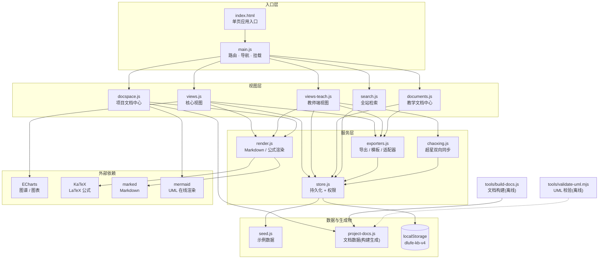

## 13. 状态图:教学文档生命周期(UML State Machine)

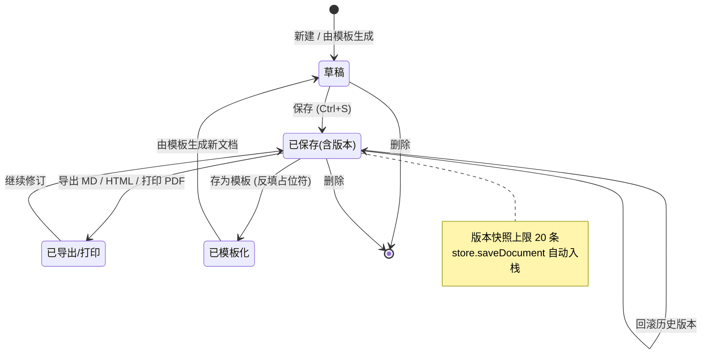

## 14. 活动图:超星双向同步闭环(UML Activity Diagram)

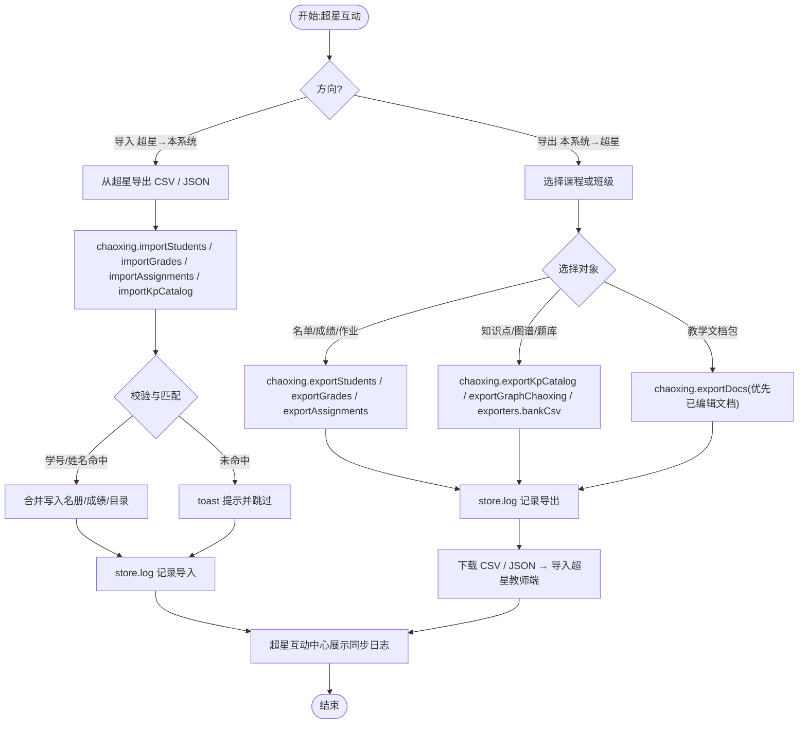

## 15. UML 图清单与审查记录

| # | 图类型 | 位置 | 主题 | 校验 |
|---|---|---|---|---|
| 1 | 上下文图 | 01 §2 | 系统边界与角色 | ✅ |
| 2 | **用例图** | 01 §3 | 17 个用例 × 7 类参与者 | ✅ 修复解析错误 |
| 3 | **类图** | 02 §2 | v4 全实体 + 适配器/注册表 | ✅ 重写对齐代码 |
| 4 | **ER 图** | 02 §3 | 21 组关系 + LOG/SCORE | ✅ 补全实体 |
| 5 | 时序图 | 02 §4.1 | 导出平台适配包 | ✅ 方法名对齐 |
| 6 | 时序图 | 02 §4.2 | AI 结果导入 | ✅ 导航/接口名对齐 |
| 7 | 时序图 | 02 §4.3 | 超星成绩回填 | ✅ 新增 |
| 8 | 部署图 | 02 §9 | 浏览器/CDN/存储/打印 | ✅ 补 CDN 与打印 |
| 9 | 类图 | 02 §11.1 | 文档实体闭环 | ✅ 补 courseId/chapterId |
| 10 | 时序图 | 02 §11.2 | 模板→文档→导出闭环 | ✅ 参与者对齐模块 |
| 11 | 数据流图 | 02 §11.3 | 项目文档网页化 | ✅ 补校验与 TOC |
| 12 | **组件图** | 02 §12 | 12 个 JS 组件分层依赖 | 🆕 新增 |
| 13 | **状态图** | 02 §13 | 教学文档生命周期 | 🆕 新增 |
| 14 | **活动图** | 02 §14 | 超星双向同步闭环 | 🆕 新增 |
| 15 | 类图 | 03 §1.1 | 课程群与角色(增量) | ✅ 字段对齐 |
| 16 | 四维模型图 | 04 §2 | 专业/课程群/课程/班级 | ✅ |
| 17 | 模块关系图 | 04 §3 | 输入→核心→输出 | ✅ |
| 18 | **用例图** | 04 §3.1 | 教师端教学任务 | 🆕 新增 |
| 19 | 数据流图 | 05 §10.2 | 数据字典驱动全链路 | 🆕 新增 |
| 20 | 组件图 | 02 §16 | 导入导出模板子系统 | 🆕 新增 |
| 21 | 数据流图 | 06 §1 | 单一数据源(模板=解析=文档) | 🆕 新增 |
| 22 | 流程图 | 06 §6 | 导入解析与校验流程 | 🆕 新增 |
| 23 | 组件图 | 06 §8 | 导入导出子系统架构 | 🆕 新增 |
| 24 | 时序图 | 06 §8 | 成绩表导入时序 | 🆕 新增 |
| 25 | 流程图 | 06 §9 | 四步使用闭环 | 🆕 新增 |

> **已修复的关键缺陷(第 5 批审查)**
> 1. **用例图渲染中断**(严重):原用例图节点 `UC9[课程导入导出(JSON 包)]` 的方括号标签内含**未转义的半角圆括号** `(`/`)`,mermaid 词法器将其判定为节点形状起始符(期望形状结束符却得到 `PS`),导致**整张用例图解析失败、页面只显示代码块**。修复:改用胶囊椭圆 `(["..."])` 并对全部含括号标签加双引号。
> 2. **类图与代码脱节**:原图仍为 v1 模型(`Major.groups`、`addGroup()/removeGroup()`、`TemplateRegistry.register/list/render(tplId)`、`PlatformAdapter <<interface>>`),与 v2/v4 实现的 `PlanCourse[] courses`、`TemplateRegistry.all/render(tpl, course, chapter)`、`Object.create(PlatformAdapter)` 适配器族及新增的班级/成绩/文档/日志实体完全不符 → 已整体重写。
> 3. **ER 图缺实体**:遗漏 CLASS / STUDENT / GRADE_ITEM / ASSIGNMENT / DOCUMENT / DOC_VERSION / LOG 及"专业—开课计划—课程"关联 → 已补全。
> 4. **时序图 API 名失真**:`exportChaoxing()`、`adapt()`、`ChaoxingAdapter`、"数据管理"入口等均为杜撰 → 改为实际的 `exporters.exportPlatform('chaoxing', cid)` → `PLATFORMS.chaoxing.exportCourse()`、`exporters.importAIResult()`、"数据与接口"。

## 11. 教学文档实体与闭环（v4 增量）

### 11.1 类图(文档实体在整体模型中的位置)

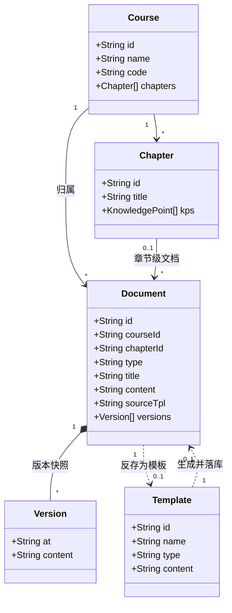

### 11.2 时序图:模板 → 文档 → 导出/打印(闭环)

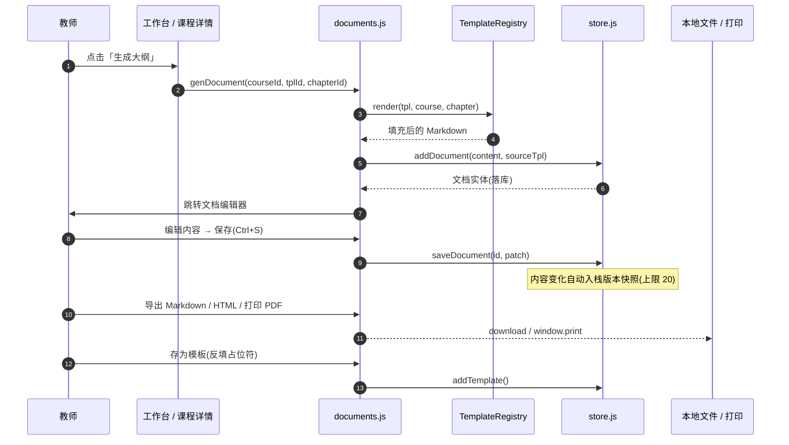

### 11.3 项目文档网页化数据流

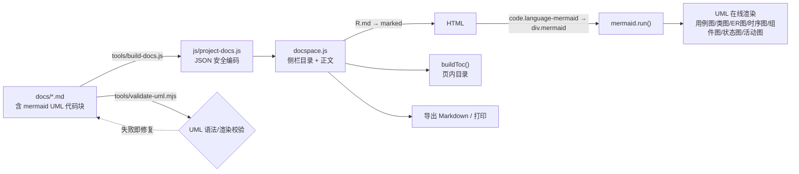

## 16. 导入导出模板子系统(UserData I/O, v5 增量)

**设计目标**:系统内**每个导入导出功能点**都提供「可直接使用的模板 + 清晰字段说明 + 多格式支持 + 超星格式兼容」。

**架构**:由 4 个前端模块协作,共享同一份数据字典,保证「模板 = 解析 = 文档」三者一致。

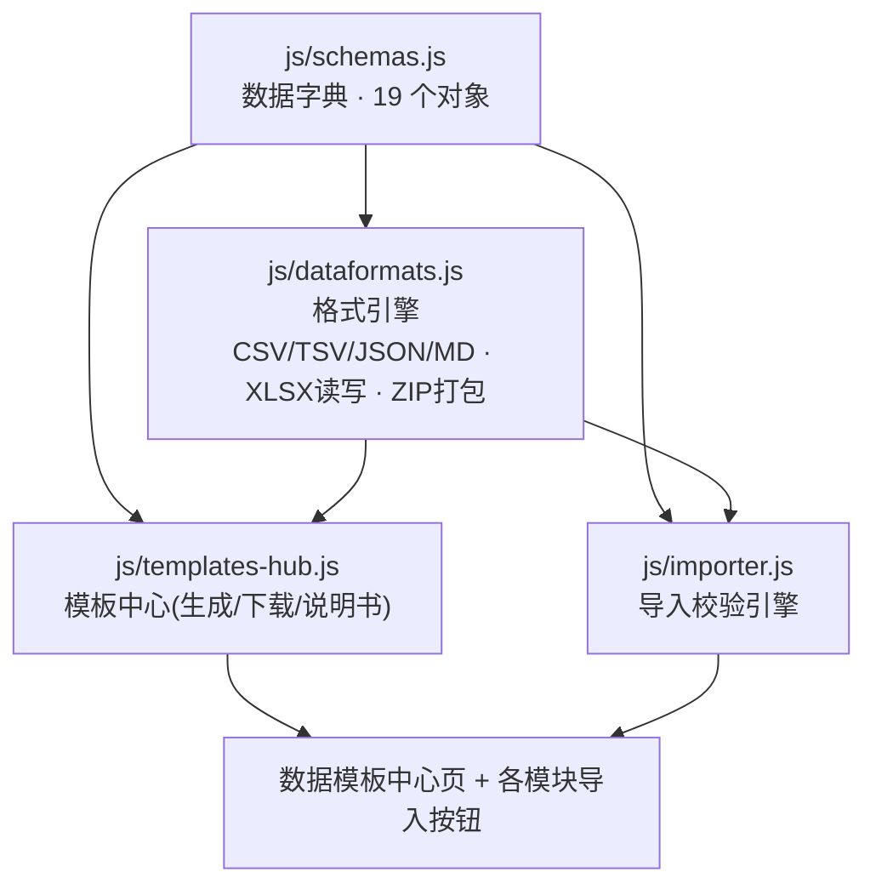

**关键类/对象**

| 组件 | 职责 | 关键 API |
|---|---|---|
| `DF`(dataformats) | 通用格式读写与打包,零外部依赖 | `csv/tsv/parseCSV/parseTSV/json/mdTable/xlsxBuild/xlsxParse/zipBuild/zipRead/readFile/detect` |
| `SCHEMAS` + `SchemaKit` | 19 个对象的字段/规则/示例(权威字典) | `get/tableFields/headers/sampleRows/fieldTable/specMd` |
| `ImportKit` | 读取 → 列名映射 → 校验 → 预览 → 写入 → 日志 | `open/parse/preview/previewJSON/commit/commitJSON` + `APPLY`/`JSON_IMPORT` 写入器 |
| `templatesHub` | 由字典实时生成模板并下载 | `build/download/downloadZip/downloadAll/readme/indexMd/startImport` |

**多格式支持**:CSV / TSV / Excel(.xlsx,真实 OOXML 双工作表) / JSON / Markdown;XLSX 解析借助浏览器原生 `DecompressionStream('deflate-raw')`,无需第三方库。每个对象另提供 **ZIP 模板包**(6 文件)。

**超星兼容**:表头匹配候选列 = 中文列名 + 同义词 + 超星列名 + 内部字段键,故超星导出文件可直接导入;导出列名复用 `SchemaKit.headers()`,故本系统导出文件列名即超星模板列名,可反向导入。

> 完整规范(功能点清单 / 字段数据字典 / 超星兼容性矩阵 / 解析规则)见 `06-导入导出模板规范.md`。

