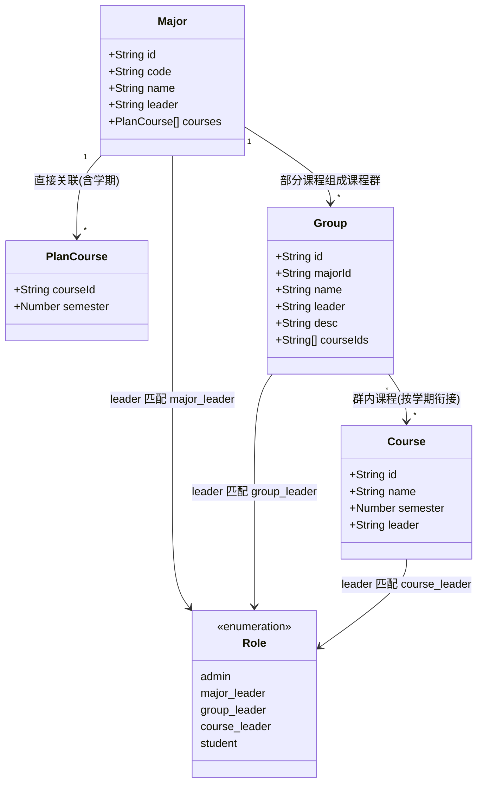

# 设计补充说明书 — 课程群体系与权限模型(v2)

版本:v2.1 | 日期:2026-10-08 | 在《02-系统设计.md》基础上的增量设计
(修订:类图字段与主类图统一,`PlanItem` → `PlanCourse`)

---

## 1. 课程群建模(v2 数据模型变更)

### 1.1 模型调整要点

> 说明:`Role` 为 `store.js` 中 `ROLES` 枚举;`PERM` 矩阵控制**模块可见性**,`auth.canW(item)` 依据 `major.leader / group.leader / course.leader` 与当前用户姓名做**数据范围**判定(按钮级启停)。

- **专业直接关联课程**:`major.courses[]` 携带开课学期(支持同一共享课程在不同专业有不同学期);
- **课程群为独立实体**(`db.groups`),与专业关联(majorId),**各设一名负责人**;群内课程是本专业课程的一个子集;
- **跨课程衔接**:知识点 `links` 可指向其他课程的知识点,课程群图谱据此呈现"低年级 → 高年级"的衔接依赖;群内课程按学期升序天然形成修读序列。

### 1.2 课程群视角知识图谱

- 节点 = 群内各课程全部知识点,按课程着色,节点按学期分列趋势布局;
- 边 = 知识点关联(含跨课程边,箭头指向前置→后续);
- 附「跨课程衔接清单」:显式列出 `课程A·知识点 → 课程B·知识点`,即课程间衔接依赖。

### 1.3 课程群负责人工作台

专属视图 `#/group`:自动定位负责人名下的课程群 → 群信息管理(名称/负责人/说明)、群内课程(按学期排序)、知识点分布一览、群视角衔接图谱、跨课程衔接清单、群课程增删(限定从所属专业课程中选取)。

## 2. 课程学期排序(修读进程)

- 专业视图按 `semester` 升序呈现"**第1学期 → 第8学期**"修读进程条;
- 课程库增加学期列;课程群内课程亦按学期排序,体现"低年级 → 高年级"覆盖。

## 3. 权限模型(五类角色)

| 模块 | 管理员 | 专业负责人 | 课程群负责人 | 课程负责人 | 学生 |
|---|---|---|---|---|---|
| 数据看板 | 读 | 读 | 读 | 读 | 读 |
| 专业管理 | **写** | **写(本专业)** | 读 | 读 | 读 |
| 课程群工作台 | **写** | **写(本专业群)** | **写(本群)** | 读 | 读 |
| 课程库 | **写** | **写** | 读 | **写(本人课程)** | 读 |
| 章节知识点/图谱维护 | **写** | 写 | **写(本群课程)** | **写(本人课程)** | 读 |
| 知识图谱查看 | 读 | 读 | 读 | 读 | 读 |
| 题库 | **写** | **写** | 读 | **写(本人课程)** | 读(练习) |
| 卷库 | **写** | **写** | 读 | **写(本人课程)** | 读 |
| 模板中心 | **写** | 读 | 读 | 读 | ✕ |
| 教学文档中心 | **写** | **写(本专业)** | **写(本群课程)** | **写(本人课程)** | 读 |
| 项目文档中心 | 读 | 读 | 读 | 读 | 读 |
| 全站检索 | 读 | 读 | 读 | 读 | 读(不含班级) |
| 数据与接口/导出 | **写** | 读 | 读 | 读(本课) | ✕ |

实现:`PERM` 权限矩阵 + `can(module)` 模块可见性 + `canW(module, item)` 数据范围校验(按 major.leader / group.leader / course.leader 与当前登录人比对)。角色通过侧边栏切换(演示模式,后续可对接统一身份认证)。
