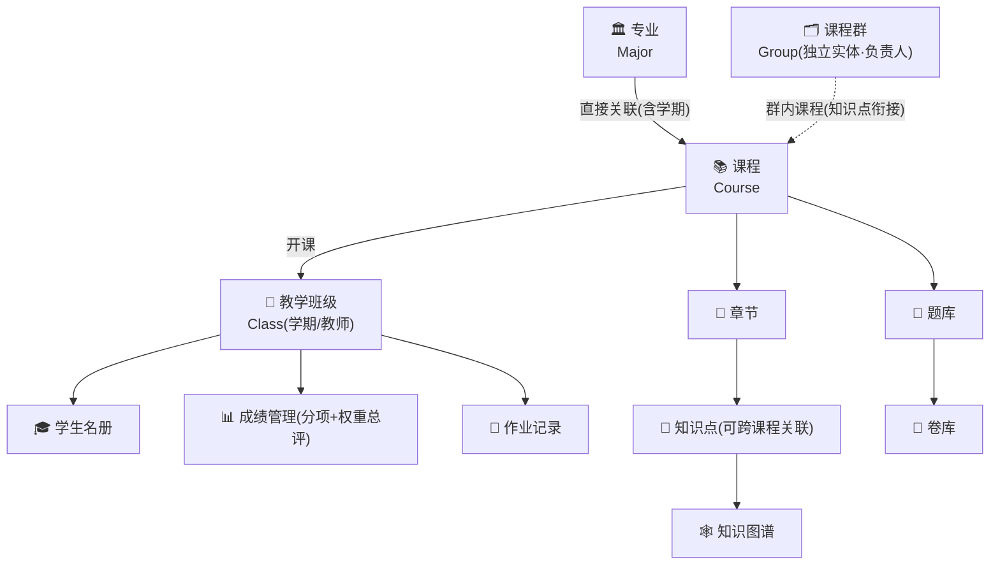
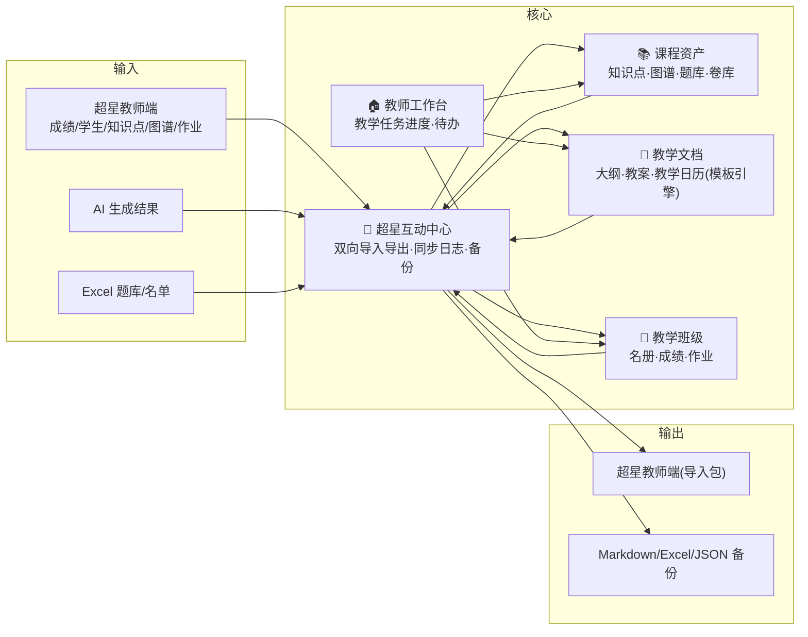
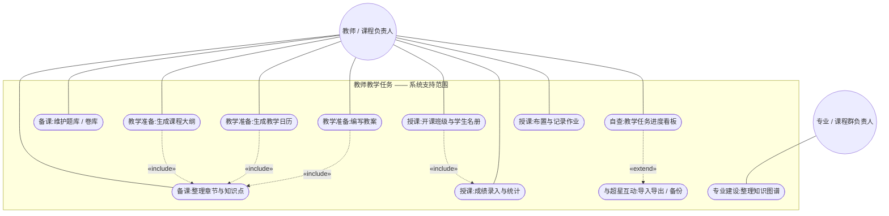

# 系统重构方案 — 面向教师的「教学知识库 · 教师工作台」

版本:v3.1 | 日期:2026-10-08 | 定位调整:从"专业知识库"→ **教师教学助手(超星教师端后台)** | 修订:新增 §3.1 教师端用例图

---

## 1. 系统定位(重新定义)

> **一句话定位**:面向高校教师的**教学知识与教学任务后台**,以"辅助教学、完善公共教学功能"为核心,把教材化的知识结构、教学文档、班级学情统一管理起来,并与**超星(学习通)教师端**双向互动,形成**信息与知识的备份**。

| 维度     | 说明                                                                  |
| ------ | ------------------------------------------------------------------- |
| 服务对象   | **教师**(课程负责人 / 课程群负责人 / 专业负责人 / 教学秘书)为主;学生为只读旁路                     |
| 核心作用   | ① 教学知识资产的结构化沉淀(知识点/图谱/题库) ② 教学任务的过程化辅助(大纲/教案/日历/成绩) ③ 与超星的双向同步与离线备份 |
| 与超星的关系 | **不是替代,而是后台与备份中心**:超星做课堂互动与在线教学,本系统做资源生产、结构化管理、批量导入导出与数据兜底          |
| 交付形态   | 纯静态站点(HTML+JS),浏览器即用、手机可访问、可发布到 WorkBuddy / GitHub Pages            |

## 2. 四个管理维度(核心骨架)

- **专业—课程群—课程**:管理**核心教学文档与教学材料**(大纲、教案、日历、知识点、图谱、题库);
- **教学班级(新增)**:把"课程"落到"某个学期的某个班级",承载**学生管理与成绩管理**;
- 四维关系:**专业/课程群是"知识资产的归属",班级是"教学过程的载体"**,均通过 `courseId` 与课程关联,数据一致。

## 3. 核心功能模块与相互关系

**相互关系要点**

1. **教师工作台**是入口:按课程列出教学任务完成度(课程信息/知识点/图谱/题库/文档/班级成绩),一键跳转或缺什么补什么;
2. **课程资产 + 教学文档**构成"知识备份"主体,全部可导出为超星可导入的格式;
3. **教学班级**是成绩与作业的容器,成绩支持**分项权重总评**与统计;
4. **超星互动中心**是所有进出的唯一通道,统一记录**同步日志**,让"谁在什么时候导了什么"可追溯。

## 3.1 教师端用例图(UML Use Case · 教师视角)

> 双圆节点 = 参与者;**胶囊椭圆 = 用例**;虚线箭头 = «include» / «extend»。
> 该图回答"**本系统到底帮教师做哪些事**",与 §3 模块关系图互补:前者是"人—功能",后者是"模块—数据"。

| 教学任务 | 系统功能落点 | 产出/去向 |
|---|---|---|
| 备课:知识点整理 | 课程库 → 章节/知识点编辑(Markdown+公式) | 知识资产,可导出超星目录 |
| 备课:题库/卷库 | 题库管理、卷库管理 | 超星题库 JSON/CSV |
| 教学准备:大纲/日历/教案 | 模板中心一键生成 → **教学文档中心在线编写** | Markdown / HTML / PDF |
| 授课:班级与成绩 | 教学班级(名册/成绩项权重总评/作业) | 成绩单 CSV,可回填超星 |
| 专业建设:知识图谱 | 知识图谱(按课程/专业/课程群过滤) | 图谱 JSON(Gephi/Neo4j) |
| 与超星互动 | 超星互动中心(双向导入导出+同步日志) | 名单/成绩/图谱/题库/文档包 |
| 自查 | 教师工作台任务进度卡(6 项核查) | 待办提示 |

## 4. 超星(学习通)双向互动矩阵

| 数据对象   | 导出(本系统 → 超星)           | 导入(超星 → 本系统)    | 格式                          |
| ------ | ---------------------- | --------------- | --------------------------- |
| 学生名单   | 班级名册导出                 | 超星班级"学生名单"导出后导入 | CSV `学号,姓名,性别,班级`           |
| 成绩     | 成绩导入表(含分项与总评)          | 超星成绩导出表回填       | CSV `学号,姓名,<分项…>,总评`        |
| 知识点/目录 | 章节-知识点目录               | 超星目录/资料清单       | CSV `章,节/知识点,内容`            |
| 知识图谱   | 图谱 JSON(节点/边)          | 图谱 JSON 合并      | JSON `{nodes,edges}`        |
| 题库     | 题库 JSON / CSV          | 超星题库导出回填        | JSON / CSV                  |
| 作业     | 作业成绩表                  | 作业批改结果          | CSV `作业标题,学号,姓名,得分,满分,截止时间` |
| 教学文档   | 大纲/教案/日历/讲义 Markdown 包 | —               | Markdown(可粘贴至超星文档)          |
| 全库     | 完整备份 JSON              | 恢复备份            | JSON                        |

> 每次导入/导出均写入**同步日志**(方向、类型、对象、条数、时间),支持"上次同步以来"的差异核对,满足**教学信息备份**诉求。

## 5. 界面与移动端方案

- **视觉**:统一 8px 栅格与卡片阴影;左侧导航改为**图标+短标签+分组**;页面统一"标题 + 一句话说明 + 操作区(Eyebar)";状态用彩色 Chip;表格首列固定可视;
- **信息密度**:教师工作台首屏呈现"任务进度环 + 我的班级 + 待办",减少点击层级;
- **手机访问**:≤820px 时——侧栏折叠为**横向可滑动导航条**,栅格自动单列,表格**横向滚动**(`.table-wrap`),成绩录入改为**卡片式逐生录入**,按钮触控加大(≥40px),成绩表在手机上支持"按学生翻页"录入;
- **响应式断点**:820px(平板竖屏)、560px(手机)。

## 6. 权限矩阵(增补)

在 v2 五类角色基础上新增两个模块权限:

| 模块        | 管理员   | 专业负责人 | 课程群负责人    | 课程负责人         | 学生 |
| --------- | ----- | ----- | --------- | ------------- | -- |
| 🏠 教师工作台  | 读     | 读     | 读         | 读             | 读  |
| 👥 教学班级   | **写** | **写** | 写(本群课程班级) | **写(本人课程班级)** | 隐藏 |
| 🔁 超星互动中心 | **写** | 写     | 写(导出)     | 写(本人课程)       | 隐藏 |

成绩数据属敏感信息:学生角色不可见班级与成绩模块;导出成绩记录同步日志。

## 7. 实施分期

| 批次        | 内容                                               | 状态      |
| --------- | ------------------------------------------------ | ------- |
| 第 1 批     | 三级结构、知识点、图谱、题库卷库、模板、导入导出                         | ✅ 已完成   |
| 第 2 批     | 课程群独立实体与工作台、学期排序、五类角色权限                          | ✅ 已完成   |
| 第 3 批(本批) | 定位重构、教学班级+学生+成绩+作业、超星双向互动中心与同步日志、教师工作台、UI 美化与移动端 | 🚧 本批交付 |
| 第 4 批(预留) | 真实登录鉴权、超星开放平台 API 直连、作业附件、成绩分析与预警                | 规划中     |
