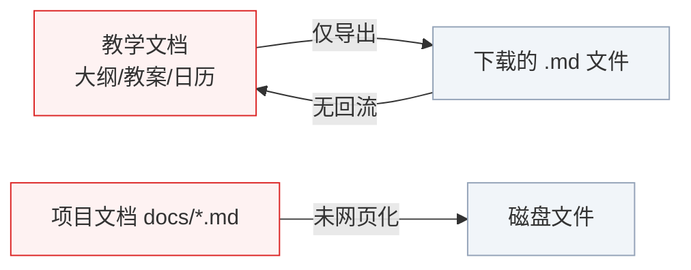
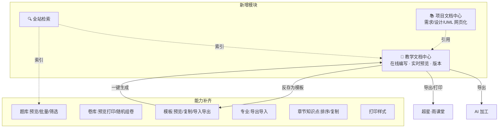
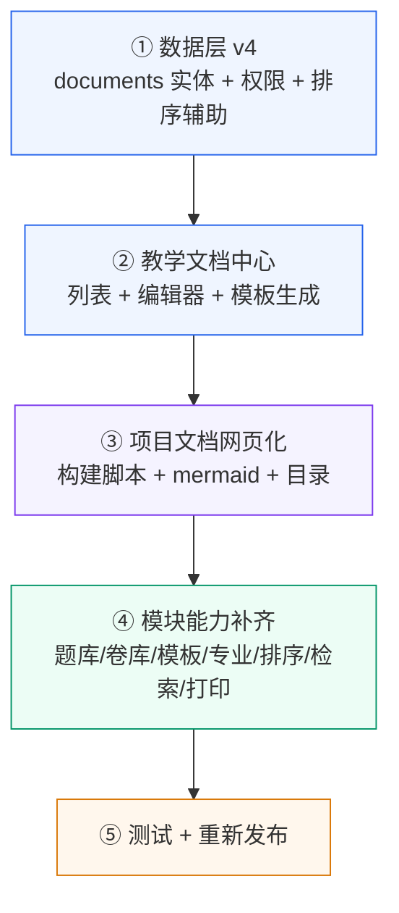
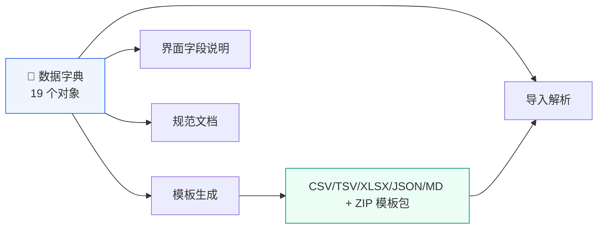

# 05 · 系统完善方案（全面审查与细节补齐）

> 版本：v4　|　日期：2026-10-08　|　适用系统：教学知识库 · 教师工作台（大连财经学院）
> 本文档由「全面审查 → 缺口清单 → 完善方案 → 优先级 → 验收标准」五部分构成，是本批次开发的纲领性文件。

---

## 一、审查范围与方法

对现有系统（数据层 `store.js`、视图层 `views.js` / `views-teach.js`、导出层 `exporters.js`、适配层 `chaoxing.js`、文档 `docs/01~04`）做逐模块走查，采用**四问法**判定完善度：

1. **可读**：内容能否在系统内在线查看？（不含下载文件）
2. **可写**：内容能否在系统内在线新建与编辑？
3. **可管理**：能否检索、排序、复制、批量、版本、删除？
4. **可闭环**：产生的产物能否回流系统（导入/落库）并再次利用？

凡四问中任一为「否」，即记为缺口。审查结论以「🕳 重大缺口 / ⚠ 一般缺口 / ○ 优化点」标注。

---

## 二、缺口清单（按模块）

| 模块 | 现状 | 判定 | 缺口说明 |
|---|---|---|---|
| **教学文档（大纲/教案/日历/讲义）** | 仅能从模板「一键导出 .md 文件」 | 🕳 | **无文档实体、无在线编写、无编辑保存、无版本、无预览、无导入**。生成即下载，无法在系统内沉淀与二次修改——这是当前最大缺口 |
| 项目文档与 UML | `docs/01~04.md` 散落磁盘 | 🕳 | 文档未网页化，UML（用例/类/时序/ER）无法在线查看 |
| 题库 | 增/删/改 | ⚠ | 无题干预览、无批量删除、无批量移动课程、无按知识点筛选 |
| 卷库 | 选题组卷、导出 md | ⚠ | 无试卷预览与打印、无随机组卷、无复制试卷 |
| 模板中心 | 注册/编辑/删除 | ⚠ | 无完整预览、无复制、无导入导出、不能「由文档反存为模板」 |
| 课程详情（章节/知识点） | 增/删/改 | ⚠ | 章节与知识点**不能排序**、章节不能复制 |
| 专业 | 增/删/改/挂接课程 | ⚠ | 无专业导出/导入（迁移与共享不便） |
| 全站 | — | ⚠ | 无跨对象的统一检索（课程/知识点/题目/文档） |
| 打印 | — | ○ | 试卷、成绩单、文档无打印样式 |
| 知识图谱 | 视图过滤+导出 | ○ | 无在线增删边（依赖知识点编辑，可接受，列入后续） |

### 缺口结构（现状问题域）



**核心病灶**：文档与知识在生产端（模板引擎）和消费端（超星/教师）之间是**单向**的——只出不进、只读不写。

---

## 三、完善方案

### 方案总览



---

### 3.1 教学文档中心（P0 · 🕳 核心缺口）

**定位**：把「模板 → 下载文件」的**单向导出**升级为「模板 → 生成文档（落库）→ 在线编辑 → 多格式导出/打印 → 反存模板」的**完整闭环**。文档成为系统内的一等实体，可按课程/章节归档，是超星教师端「教学文档」的后台与备份。

**数据模型**：`db.documents[]`

| 字段 | 说明 |
|---|---|
| `id / title` | 唯一标识 / 标题 |
| `courseId / chapterId` | 归属课程 / 章节（章节级文档如教案） |
| `type` | 文档类型：大纲 syllabus / 日历 calendar / 教案 lesson / 讲义 handout / 其他 other |
| `content` | Markdown 正文（支持 LaTeX 公式、表格、代码块、图片） |
| `sourceTpl` | 来源模板 id（可追溯，支持下划线复用） |
| `versions[]` | 版本快照（时间 + 内容），支持回滚 |
| `createdAt / updatedAt` | 时间戳 |

**新增功能点**

| # | 功能 | 优先级 | 预期效果 |
|---|---|---|---|
| D1 | 文档列表：按课程/类型筛选 + 关键字搜索 | P0 | 快速定位任一课程的大纲/教案/日历 |
| D2 | **从模板一键生成文档并落库**（替代仅下载） | P0 | 生成即入库，立即可编辑，工作台快捷入口直达 |
| D3 | **在线编辑器**：左编辑右实时预览（公式/表格/代码即时渲染） | P0 | 教师无需外部工具即可撰写与修订 |
| D4 | 编辑工具栏：标题/加粗/列表/表格/公式/图片/代码/链接 | P0 | 零语法门槛，降低使用成本 |
| D5 | 保存 / 另存为副本 / 删除 | P0 | 文档全生命周期管理 |
| D6 | **版本历史与回滚** | P1 | 防止误改，可追溯修订过程 |
| D7 | 导出 Markdown / HTML，**浏览器直接打印为 PDF** | P0 | 无缝对接超星文档与线下打印 |
| D8 | 导入本地 Markdown 成为文档 | P1 | 已有资料快速入库，闭环 |
| D9 | **由文档反存为模板**（替换正文为占位符草稿） | P2 | 沉淀个人/校级模板资产 |
| D10 | 空白新建（非模板） | P1 | 满足临时文档需求 |

**预期效果**：系统从「文档生成器」升级为「文档生产与管理平台」，`doc` 模块成为继知识点之后的第二类核心资产。

---

### 3.2 项目文档中心（P0 · 🕳 文档网页化）

**目标**：将 `docs/01~06` 及全部 UML 过程**网页化**，站内在线直接观看。

**新增功能点**

| # | 功能 | 优先级 | 预期效果 |
|---|---|---|---|
| P1 | 侧栏目录 + 正文渲染（Markdown） | P0 | 单页内切换需求/设计/权限/完善方案 |
| P2 | **Mermaid 在线渲染 UML**（用例图/类图/时序图/ER 图/流程图） | P0 | UML 过程可视化，随数据实时绘制 |
| P3 | 自动生成页内目录（TOC，h2/h3 锚点） | P1 | 长文档快速跳转 |
| P4 | 文档内检索与高亮 | P1 | 快速定位关键内容 |
| P5 | 一键打印 / 导出单文档 | P1 | 用于归档与线下评审 |
| P6 | 文档数据构建脚本（`docs/*.md` → `js/project-docs.js`） | P1 | 文档与站点同源，改 md 即改站 |

> 实现要点：引入 `mermaid`，将 marked 渲染出的 ` ```mermaid ` 代码块替换为图形容器并 `mermaid.run()` 渲染；无网络时降级为代码块原文，不阻塞页面。

---

### 3.3 题库管理（P1）

| # | 功能 | 优先级 | 预期效果 |
|---|---|---|---|
| Q1 | 题干**预览弹窗**（选项/答案/解析，公式渲染） | P0 | 无需进入编辑即可核对 |
| Q2 | **批量选择 + 批量删除 / 批量移动到课程** | P1 | 大批量整理效率倍增 |
| Q3 | 按**知识点**筛选（联动课程） | P1 | 与知识图谱/大纲对齐管理 |
| Q4 | 全选/反选、筛选后计数 | P2 | 批量操作更精准 |

### 3.4 卷库管理（P1）

| # | 功能 | 优先级 | 预期效果 |
|---|---|---|---|
| E1 | **试卷预览**（标准卷面：题号/选项/留白，公式渲染） | P0 | 所见即所得 |
| E2 | **打印视图**（浏览器打印为 PDF，含页眉） | P0 | 直接用于印刷 |
| E3 | **随机组卷**（按题型/难度/数量自动抽题） | P1 | 快速生成练习卷/AB 卷 |
| E4 | 复制试卷 | P2 | 复用卷面结构 |

### 3.5 模板中心（P1）

| # | 功能 | 优先级 | 预期效果 |
|---|---|---|---|
| T1 | **完整预览**（模板原文 + 以示例课程填充的效果预览） | P0 | 注册模板前先看效果 |
| T2 | 复制模板 | P1 | 派生变体 |
| T3 | 模板**导出/导入 JSON** | P1 | 模板可在校际/教师间共享 |
| T4 | 由文档反存模板（联动 D9） | P2 | 沉淀资产 |

### 3.6 课程详情 · 章节与知识点（P1）

| # | 功能 | 优先级 | 预期效果 |
|---|---|---|---|
| C1 | 章节**上移/下移**（调整教学顺序） | P0 | 章节顺序即授课顺序 |
| C2 | 知识点**上移/下移** | P1 | 知识点顺序可控 |
| C3 | **章节复制**（含知识点与内部关联） | P1 | 相似章节快速派生 |
| C4 | 课程级「生成大纲/日历/教案」→ **直达文档编辑器** | P0 | 与文档中心打通 |

### 3.7 其他改进（P1–P2）

| # | 模块 | 功能 | 优先级 | 预期效果 |
|---|---|---|---|---|
| M1 | 专业 | 专业**导出/导入 JSON**（含课程群与课程引用） | P1 | 专业级迁移与共享 |
| S1 | 全站 | **统一检索**（课程/知识点/题目/文档/班级） | P1 | 一处搜全站 |
| R1 | 全局 | **打印样式**（打印时隐藏导航与按钮） | P0 | 试卷/成绩单/文档可直接打印 |
| R2 | 权限 | 新增 `docs` / `docspace` / `search` 模块权限 | P0 | 角色可见性一致 |
| K1 | 知识图谱 | 在线增删边（节点拖拽连线） | P2 | 后续迭代 |

---

## 四、权限增补

| 模块 | 管理员 | 专业负责人 | 课程群负责人 | 课程负责人 | 学生 |
|---|---|---|---|---|---|
| `docs` 教学文档 | w | w(本专业) | w(本群课程) | w(本人课程) | r |
| `docspace` 项目文档 | r | r | r | r | r |
| `search` 全站检索 | r | r | r | r | r |

> 复用 `auth.canW('docs', doc)`：文档按 `courseId` 归属课程做数据范围校验（与题库/班级一致）。

---

## 五、优先级与实施顺序



- **P0（本次必达）**：文档中心（D1–D5,D7）、项目文档网页化（P1,P2）、打印样式（R1）、权限（R2）、题库预览（Q1）、卷库预览打印（E1,E2）、模板预览（T1）、章节排序（C1,C4）。
- **P1（本次达成）**：版本/导入/空白新建（D6,D8,D10）、TOC/检索/构建脚本（P3–P6）、批量与筛选（Q2,Q3）、随机组卷（E3）、模板复制导入导出（T2,T3）、知识点排序与章节复制（C2,C3）、专业导入导出（M1）、全站检索（S1）。
- **P2（迭代预留）**：反存模板（D9,T4）、图谱在线连边（K1）、卷库复制（E4）。

---

## 六、验收标准

1. **闭环**：任一课程可从「模板 → 生成文档 → 在线编辑 → 导出 MD/HTML/打印 → 导入回流」全流程走通，无需外部工具。
2. **网页化**：站内可查看需求分析、系统设计、课程群与权限设计、教师端重构方案、系统完善方案、导入导出模板规范六份文档，且 UML 图（mermaid）正确渲染。
3. **一致性**：新增模块纳入导航与权限矩阵，五种角色的可见性/可写性无越权。
4. **健壮性**：`test/smoke.test.js` 全量通过（含新模块的渲染与挂载）；老数据（v1/v2/v3）自动迁移至 v4 不丢数据。
5. **可用性**：桌面端与手机端（≤820px）均可正常编写与查看文档。

---

## 七、数据迁移说明（v3 → v4）

- 新增 `db.documents = []`（空则按种子生成示例文档）。
- `settings` 增加 `docAutoVersion`（默认 true）。
- 存量 `courses / majors / groups / classes / bank / papers / templates / logs` 结构不变，安全无损。

---

## 八、UML 图全量审查与修正（第 5 批 · P0）

### 8.1 审查方法

引入离线校验器 `tools/validate-uml.mjs`：从 `docs/*.md` 提取全部 mermaid 代码块，用**与线上同版本的 mermaid 10.9.1** 在 jsdom 中**真实 `parse()` + `render()`**，逐一报告解析/渲染错误。这使"图是否能渲染"从"靠肉眼看页面"变为**可自动回归的检查项**。

### 8.2 审查结论与修正（按优先级）

| 优先级 | 缺陷 | 根因 | 修正 |
|---|---|---|---|
| **P0** | **用例图整张无法渲染**(页面只显示代码块) | `UC9[课程导入导出(JSON 包)]` 方括号标签内含**未转义的半角圆括号**;mermaid 词法器把 `(` 当作节点形状起始符(期望形状结束符却得到 `PS`),**首个错误即中断整图** | 用例改用胶囊椭圆 `(["..."])` 并对所有含括号标签加双引号;重绘为规范用例图(17 用例 × 7 参与者 + «include»/«extend») |
| **P0** | 类图与 v4 代码**完全脱节** | 图停留在 v1:`Major.groups`、`addGroup()/removeGroup()`、`TemplateRegistry.register/list/render(tplId)`、`PlatformAdapter <<interface>>` 均非实现 | 整体重写:补 `PlanCourse`、班级/学生/成绩项/作业/文档/版本/日志实体、`PLATFORMS` 适配器族、`TemplateRegistry.all/render(tpl,course,chapter)`;修正组合/聚合/关联符号 |
| **P1** | ER 图漏实体 | 未含 CLASS/STUDENT/GRADE_ITEM/ASSIGNMENT/DOCUMENT/DOC_VERSION/LOG 及"专业—开课计划—课程"关联 | 补全至 21 组关系,并拆解出 `SCORE` 关联实体 |
| **P1** | 时序图 API 名失真 | `exportChaoxing()`、`adapt()`、`ChaoxingAdapter`、"数据管理"入口等为杜撰 | 改为真实调用链 `exporters.exportPlatform('chaoxing',cid)` → `PLATFORMS.chaoxing.exportCourse()`;`exporters.importAIResult()`;入口名"数据与接口";新增超星成绩回填时序图 |
| **P2** | 缺失 UML 图 | 工程化项目缺"组件/状态/活动"视图,教师视角缺用例图 | 新增:`§12 组件图`(12 个 JS 组件分层依赖)、`§13 状态图`(文档生命周期)、`§14 活动图`(超星双向同步闭环)、`04 §3.1 教师端用例图` |
| **P2** | 文档版本与分期滞后 | 01/02 仍标 v1.0;分期计划未含第 2–5 批 | 更新版本号与分期表;01 补 FR-14～FR-23 需求条目 |

### 8.3 操作指引（避免同类问题复发）

1. **方括号标签含半角括号必须加引号**:写 `A["文本(说明)"]` 而非 `A[文本(说明)]`;或改用全角括号 `（）`;或改用椭圆 `A(["文本(说明)"])`。
2. **改完文档必跑校验**:`node tools/validate-uml.mjs` —— 当前 **28 图应全绿(0 失败)**。
3. **校验-构建-发布**三步顺序:`validate-uml.mjs` → `build-docs.js` → 重新发布。

---

## 十、导入导出模板体系（第 6 批 · P0）

### 10.1 缺口

原系统的导入导出点是**碎片化**的：每个模块各自写解析/导出代码、各自的列名与格式，导致三个问题——

| 问题 | 表现 |
|---|---|
| 🕳 **无标准模板** | 用户不知该按什么列名、什么格式准备文件；下载到的只是数据快照，不是"可直接填写的空模板" |
| 🕳 **无字段说明** | 各列含义、必填项、取值要求散落，新教师无从下手 |
| ⚠ **格式单一且不对齐** | 多为单一 CSV；与超星（学习通）导出模板列名不一致，需手工改列 |

### 10.2 方案:一份数据字典驱动全链路

引入 **数据字典（`js/schemas.js`）** 作为唯一事实源，同时驱动 **模板生成 / 导入解析 / 界面说明 / 规范文档** 四者，从根本上消除"模板与解析不一致"。



### 10.3 交付清单

| # | 能力 | 说明 |
|---|---|---|
| A1 | **通用数据格式引擎** `dataformats.js` | 零依赖实现 CSV/TSV/JSON/Markdown 读写；真实 XLSX（OOXML 双工作表）读写；真实 ZIP 打包/解包（CRC32 + DecompressionStream） |
| A2 | **全量数据字典** `schemas.js` | 19 个对象 × 字段（含义/必填/类型/格式/示例/超星列）+ 填写规则 + 示例数据 |
| A3 | **导入校验引擎** `importer.js` | 列名同义词映射 → 必填/枚举/数值校验 → 预览确认 → 写入 + 日志；支持动态列（成绩项）与 JSON 对象导入 |
| A4 | **数据模板中心** `templates-hub.js` | 概览 + 搜索 + 单对象字段字典页 + 多格式下载 + ZIP 模板包 + README + 全部模板打包 |
| A5 | **改造全部导入导出点** | 题库/名单/成绩/作业/班级/专业/课程/知识点/图谱/文档…全部接入模板下载与多格式导入 |
| A6 | **超星兼容** | 表头候选列含超星列名与同义词；导出列名复用模板表头（可反向导入超星） |
| A7 | **规范文档** | `docs/06-导入导出模板规范.md`（功能点清单 / 格式规范 / 字段字典 / 超星矩阵 / 解析规则 / 验收） |

### 10.4 关键设计决策

1. **模板即导出格式**：导出列名 = 数据字典表头 → **导出文件可直接再导入**（往返无损），杜绝"导出后无法回灌"。
2. **同义词 + 超星列名 + 内部键三合一匹配**：既兼容人工填写的多种列名，又让超星导出文件零改动导入，还让导出的 JSON 能再导入。
3. **动态列**：成绩表的"成绩项列"不写死——除关键词列外每列皆为一个成绩项，列名与超星导出一致即写入。
4. **ZIP 模板包**：单个对象一次下载 6 个文件（CSV/TSV/XLSX/JSON/字段说明.md/README.txt），覆盖所有编辑习惯。
5. **前端零依赖**：XLSX/ZIP 均在浏览器端自实现，保持静态站点可离线部署的特性。

### 10.5 验收

见 `06-导入导出模板规范.md` §十：19 个功能点全覆盖、模板示例数据 0 错误、5 种格式可识别、超星双向兼容、导出可回灌；`test/smoke.test.js` 全绿。

---

## 十一、验收标准（增补）

6. **UML 完整性**：`node tools/validate-uml.mjs` 输出 **0 失败**；全部图在项目文档中心（`#/docspace`）正确渲染为矢量图。
7. **图码一致**：类图/ER 图字段与 `store.js`/`seed.js` 实体一致；时序图参与者与调用名与 `exporters.js`/`chaoxing.js`/`documents.js` 一致。
8. **模板完备性**：系统内每个导入导出功能点均可在「数据模板中心」找到可直接使用的模板与字段说明；模板示例数据可 0 错误导入。
9. **多格式与超星兼容**：CSV/TSV/XLSX/JSON/MD 均可识别；超星列名可被同义词识别，本系统导出列名即超星模板列名。

---

## 十二、首页改版与白屏根治（第 7 批 · P0）

### 12.1 首页重设计

- **信息层级**：欢迎条（问候语 + 角色 + **可修改的当前学期**）→ 四张关键指标卡 → 教学任务进度（按课程）→ 我的班级与成绩录入 / 最近同步 → 学情图表。
- **角色差异化**：管理员/专业负责人/课程群负责人/课程负责人看到"待录成绩项、生成大纲、开课班级"等教学动作；**学生**首页只呈现课程资源与进度，不出现任何教学动作。
- **快捷入口**：卡片按 `auth.canSee(module)` 实时过滤，不可见模块不会出现（权限与界面始终一致）。
- **使用说明入口**：欢迎条与侧栏均可一键跳转 `#/help`——分角色详细使用说明页（角色定位 / 可见模块 / 推荐工作流 / 常见问题），模块可见性表由 `PERM` 实时推导。
- **学期可修改**：首页学期下拉调用 `store.setTerm()`，写入 `settings.term` 并记一条"学期设置"日志；「教学班级」的学期筛选改为 URL 参数（`#/classes?term=…`），**不再误改全局学期设置**。

### 12.2 白屏（页面为空）根因分析与根治 ★

**现象**：打开 `index.html` 后页面完全空白。

**排查路径（可复现）**：

1. 全量语法检查 + 沙箱按序加载全部脚本 → 全部通过，无语法/加载错误。
2. `tools/boot-check.js`（新增）在沙箱内真实触发 `DOMContentLoaded` → `#main` 渲染出 16KB 内容，说明**代码本身正常**。
3. 真实浏览器（agent-browser + Chromium）打开并逐路由检查 → `#main` 内容 16553 字符、16 个路由全部渲染成功（1284～128313 字符）、4 个库全局均就位。
4. **受控实验**：让 `<head>` 中一个同步脚本指向"只接受连接、永不响应"的黑洞服务 → 浏览器**永远停在解析阶段、页面持续全白**（实验进程挂起 25 分钟未返回）。

**根因**：`index.html` 的 `<head>` 中，**echarts / marked / mermaid 三个脚本是同步、渲染阻塞的**，且全部指向外部 CDN（`cdn.jsdelivr.net`）。当该 CDN 不可达或响应挂起时（离线、内网、受限网络、sandboxed 预览等场景非常常见），HTML 解析器会停在这几个 `<script>` 上等待，`<body>` 永远不被解析与绘制 → **整页空白**。这也是该站点在"能联网的机器上正常、在受限网络下空白"的原因。

**修复（三层防御）**：

| 层 | 措施 | 效果 |
|---|---|---|
| ① 依赖本地化 | 新增 `libs/`，把 echarts / marked / katex（含 20 个 woff2 字体）本地化，`index.html` 不再引用任何外部地址 | 彻底消除对外部 CDN 的启动依赖，可离线/内网运行 |
| ② 大库按需加载 | mermaid（约 3.2MB）移出首屏，改由 `docspace.js` 的 `ensureMermaid()` 在**首次打开项目文档时**动态加载 | 首屏更轻；UML 仍正常渲染 |
| ③ 渲染兜底 | `main.js` 将路由拆为 `route()`/`routeInner()`，`route()` 捕获异常并渲染提示卡片；启动流程的 `store.load()`/`initNav()` 各自容错，末尾**始终**调用 `route()` | 任一视图/初始化异常都不再导致整页空白 |

**验证**：`libs` 资源齐全性、`index.html` 零外部引用、katex 字体完整性、mermaid 首屏不加载、`route` 异常兜底、启动容错——均已纳入 `test/smoke.test.js` 回归测试；真实浏览器复核：首屏 `typeof window.mermaid === 'undefined'`、脚本列表全部为本地路径、打开项目文档后 mermaid 加载并渲染出 **2 个 SVG**。

### 12.3 本批顺带的清理

- 移除已废弃的 `viewDashboard`/`mountDashboard` 死代码（首页统一为 `viewHome`）。
- 导航项补充 `desc` 描述，鼠标悬停可见；`initNav()` 统一渲染角色盒。
- 新增 `tools/boot-check.js`（启动自检）与 `tools/audit.js`（静态审查）两个开发期工具。

---

*附录：术语与实现映射见 `02-系统设计.md`；课程群与权限的完整矩阵见 `03-课程群与权限设计.md`；教师端定位见 `04-教师端重构方案.md`；导入导出规范见 `06-导入导出模板规范.md`。*
