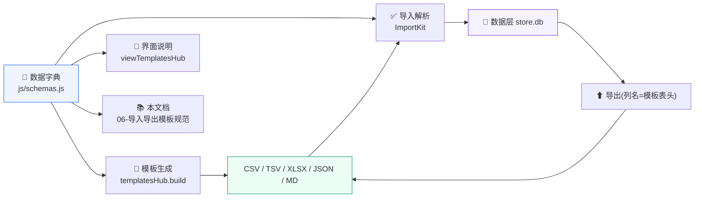
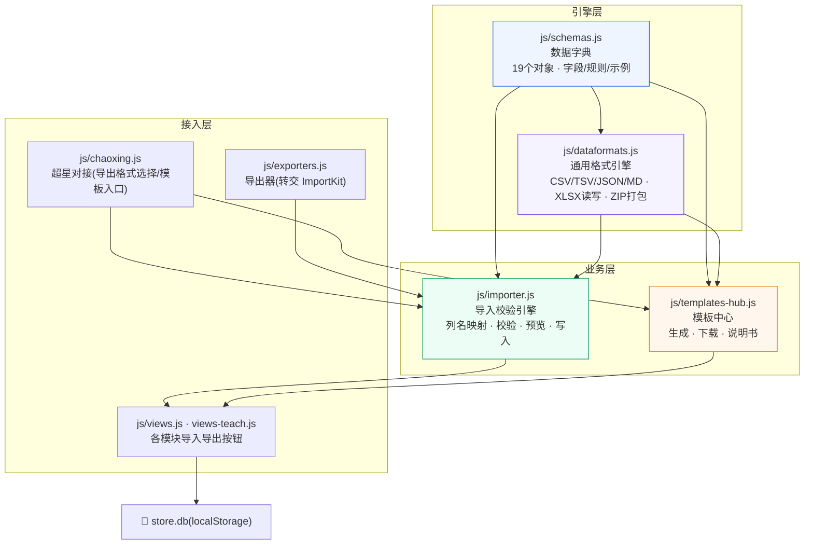
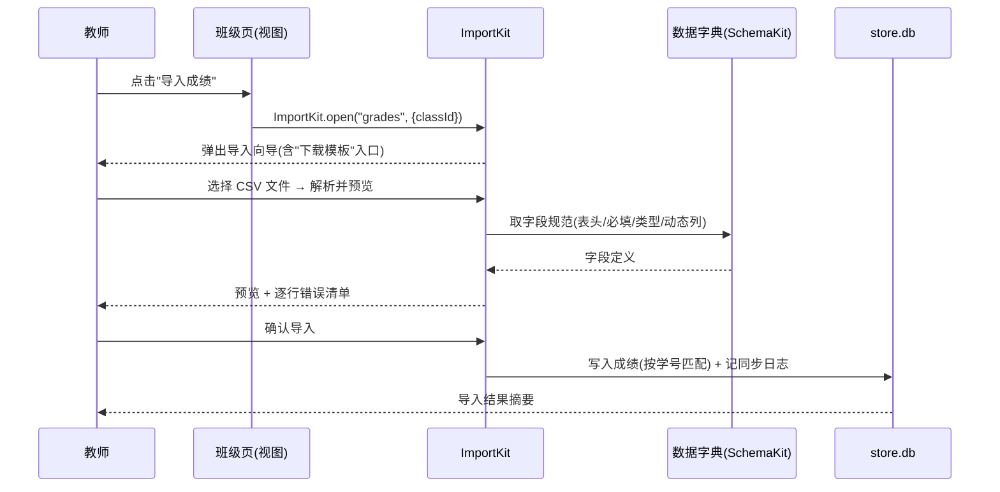

# 06 · 导入导出模板规范（数据字典 · 多格式 · 超星对接）

> 版本：v1　|　日期：2026-10-08　|　适用系统：教学知识库 · 教师工作台（大连财经学院）
> 本文档是系统内**全部导入导出功能点**的统一规范：功能点清单 → 支持的文件格式 → 字段数据字典 → 超星（学习通）兼容性矩阵 → 解析校验规则 → 导出可回灌规则。

---

## 一、设计目标与原则

**目标**：系统内每一个涉及数据导入/导出的功能点，都必须同时具备三件套——

1. **可直接使用的模板**（下载即填、填完即导）；
2. **清晰的使用说明**（字段含义 / 必填项 / 格式要求 / 示例数据）；
3. **与超星（学习通）导入导出格式的兼容**（列名对齐，可双向无改动流转）。

**核心原则：单一数据源（Single Source of Truth）。**

全系统的「模板生成」「导入解析」「界面字段说明」「本文档」四者共用同一份**数据字典** `js/schemas.js`。因此：

- 模板里的列名 = 解析器识别的列名 = 文档里写的列名（**不可能不一致**）；
- 改一处数据字典，模板、解析、说明、文档同步生效；
- 导出的文件列名即模板表头，**导出的文件可直接再导入**（往返无损）。

---

## 二、功能点全量清单

系统共有 **19 个导入导出对象**，覆盖 5 个类别。任一对象的模板均可在「数据模板中心」（导航 → 📋 数据模板）下载。

| # | 类别 | 对象 | 方向 | 支持格式 | 超星对应入口 |
|---|---|---|---|---|---|
| 1 | 专业与课程计划 | 课程基本信息 | 导入 + 导出 | CSV/TSV/Excel/JSON | 教师端 → 课程管理 → 新建课程 |
| 2 | 专业与课程计划 | 专业与修读计划 | 导入 + 导出 | CSV/TSV/Excel/JSON | 教务数据导入（培养方案） |
| 3 | 课程与知识资产 | 章节结构（大纲骨架） | 仅导入 | CSV/TSV/Excel/JSON | 课程 → 目录 → 批量导入章节 |
| 4 | 课程与知识资产 | 知识点目录（章节+知识点） | 导入 + 导出 | CSV/TSV/Excel/JSON | 课程 → 目录 / 资料 → 导入 |
| 5 | 课程与知识资产 | 知识图谱（节点与关联边） | 导入 + 导出 | JSON / CSV / Excel | 知识图谱 → 导入 / 图谱工具 |
| 6 | 课程与知识资产 | 题库（题目导入导出） | 导入 + 导出 | CSV/TSV/Excel/JSON | 题库 / 作业库 / 考试库 → 批量导入 |
| 7 | 课程与知识资产 | 试卷结构（卷库） | 仅导入 | CSV/TSV/Excel/JSON | 考试 → 组卷 / 试卷导入 |
| 8 | 教学文档 | 教学文档（大纲/教案/日历/讲义） | 导入 + 导出 | JSON / Markdown | 课程 → 文档 / 资料 / 教案模块 |
| 9 | 教学班级与成绩 | 教学班级 | 仅导入 | CSV/TSV/Excel/JSON | 我的班级 → 新建班级 / 教务选课 |
| 10 | 教学班级与成绩 | 学生名单 | 导入 + 导出 | CSV/TSV/Excel/JSON | 班级管理 → 学生名单 → 导入/导出 |
| 11 | 教学班级与成绩 | 成绩表（分项 + 总评） | 导入 + 导出 | CSV/TSV/Excel/JSON | 成绩管理 → 导出成绩 / 导入成绩 |
| 12 | 教学班级与成绩 | 作业成绩 | 导入 + 导出 | CSV/TSV/Excel/JSON | 作业 → 导出成绩 / 导入成绩 |
| 13 | 教学班级与成绩 | 成绩项与权重设置 | 仅导入 | CSV/TSV/Excel/JSON | 成绩管理 → 成绩权重设置 |
| 14 | 平台对接与系统 | 课程包（课程+图谱+题库+卷库） | 导入 + 导出 | JSON | 课程 → 复制课程 / 导出资源包 |
| 15 | 平台对接与系统 | 专业包（专业+课程+课程群） | 导入 + 导出 | JSON | 教务/专业建设数据 |
| 16 | 平台对接与系统 | 文档模板库 | 导入 + 导出 | JSON | 课程 → 文档模板（上游标准） |
| 17 | 平台对接与系统 | AI 加工清单 | 仅导出 | JSON | （中间产物，供大模型加工） |
| 18 | 平台对接与系统 | AI 生成结果（回填导入） | 仅导入 | JSON | 结果再经题库模板导入超星 |
| 19 | 平台对接与系统 | 全库备份（灾备与迁移） | 导入 + 导出 | JSON | （系统级备份，不对应超星入口） |

> **模板包（ZIP）**：每个对象可一键下载模板包，内含 `CSV` + `TSV` + `Excel(.xlsx，含"字段说明"第二页)` + `JSON` + `字段说明.md` + `README.txt` 六个文件，解压即可用。点击「下载全部模板(ZIP)」可一次获得全部 19 个对象的模板（按类别分目录，另附 `总目录.md`）。

---

## 三、支持的文件格式规范

系统内所有导入点均可识别下列 5 种常见格式，导出点按对象特性提供其中若干种。

| 格式 | 扩展名 | 适用场景 | 编码与注意事项 |
|---|---|---|---|
| **CSV** | `.csv` | 通用表格，Excel / WPS 双击可开 | **必须 UTF-8**（导出带 BOM，Excel 不乱码）；逗号分隔；含逗号/换行/引号的单元格用英文双引号包裹，内部引号写成两个（`""`） |
| **TSV / 制表符** | `.tsv` | 从 Excel 直接复制粘贴即可得到；适合含大量逗号的文本 | UTF-8；制表符分隔；系统会**自动嗅探分隔符**，`.txt` 亦可 |
| **Excel** | `.xlsx` | 最直观的表格编辑方式 | 真实 OOXML；模板含 **2 个工作表**：第 1 页「数据」填写、第 2 页「字段说明」查阅；导入读取第 1 页 |
| **JSON** | `.json` | 结构最完整，支持公式、多层级对象 | UTF-8；**请勿改动字段名**；推荐用于课程包/题库/图谱/AI 回填 |
| **Markdown** | `.md` | 文档型内容（大纲/教案/讲义/字段说明） | UTF-8；可直接粘贴到超星文档模块；支持 KaTeX 公式 |

**统一读取行为**：上传文件后系统按扩展名 → MIME → 内容嗅探的顺序判定格式；`.xls`（旧版）按 `.xlsx` 处理（若为二进制旧格式建议先另存为 `.xlsx`）。

**Excel 另存技巧**：用 Excel 编辑 CSV 后保存时，请选择 **「CSV UTF-8（逗号分隔）(.csv)」**，否则中文会乱码——这是导入失败最常见的原因。

---

## 四、字段数据字典

> 下表为各对象的**字段级规范**：列名 / 含义 / 必填 / 类型 / 格式要求 / 示例 / 超星对应列。
> 表格类对象（CSV/TSV/Excel）按列名匹配，**列顺序可任意调整、列名不要改写**；导入时列名支持同义词自动识别（如「学号 / 学生学号 / 账号 / 工号」等价）。

### 4.1 专业与课程计划

**① 课程基本信息**（导入 + 导出）

| 列名 | 含义 | 必填 | 类型 | 格式要求 | 示例 | 超星对应列 |
|---|---|---|---|---|---|---|
| 课程代码 | 唯一标识；按代码匹配，已存在则更新 | ✔ | 文本 | 字母+数字，如 BX211001 | BX211001 | 课程编号 |
| 课程名称 | 课程全称 | ✔ | 文本 | — | Python程序设计 | 课程名称 |
| 学分 | 用于大纲/培养方案统计 | 选填 | 数值 | 0.5~10，可含 0.5 | 3 | 学分 |
| 学时 | 总学时 | 选填 | 数值 | 整数 8~128 | 48 | 学时 |
| 开课学期 | 默认开课学期 | 选填 | 数值 | 1~8 的整数 | 2 | 开课学期 |
| 课程负责人 | 用于数据范围校验与占位符 | 选填 | 文本 | — | 王伟 | 教师 |
| 课程类别 | 分类与统计 | 选填 | 文本 | 专业核心课 / 专业基础课 / 通识必修 / 选修 | 专业核心课 | — |
| 课程简介 | 填入大纲"课程简介" | 选填 | 多行 | 200 字以内 | 以数据应用为导向… | — |
| 教学目标 | 填入大纲"课程目标" | 选填 | 多行 | 多条用 `;` 或换行分隔 | 掌握基础语法;能处理业务数据 | — |

**② 专业与修读计划**（导入 + 导出）— 一行 = 一个「专业 × 课程」挂接

| 列名 | 含义 | 必填 | 类型 | 格式要求 | 示例 | 超星对应列 |
|---|---|---|---|---|---|---|
| 专业代码 | 专业唯一标识 | ✔ | 文本 | 教育部专业代码 | 120108T | — |
| 专业名称 | 专业全称 | ✔ | 文本 | — | 大数据管理与应用 | — |
| 专业负责人 | 用于数据范围 | 选填 | 文本 | — | 刘院长 | — |
| 课程代码 | 须已存在课程库 | ✔ | 文本 | 匹配不到记入错误清单 | BX211001 | — |
| 修读学期 | 该课程在本专业开课学期 | ✔ | 数值 | 1~8 的整数 | 2 | 开课学期 |

### 4.2 课程与知识资产

**③ 章节结构（大纲骨架）**（仅导入）

| 列名 | 含义 | 必填 | 类型 | 格式要求 | 示例 |
|---|---|---|---|---|---|
| 课程代码 | 匹配课程库 | ✔ | 文本 | — | BX211001 |
| 章序号 | 决定章节顺序 | 选填 | 数值 | 1、2、3… | 1 |
| 章标题 | 章节名称（同名视为已存在） | ✔ | 文本 | — | 第1章 Python概述 |
| 学时 | 决定教学日历周次分配 | 选填 | 数值 | 整数，默认 4 | 4 |

**④ 知识点目录（章节+知识点）**（导入 + 导出）— 一行 = 一个知识点

| 列名 | 含义 | 必填 | 类型 | 格式要求 | 示例 | 超星对应列 |
|---|---|---|---|---|---|---|
| 章 | 留空归入"未分章"；不存在自动创建 | 选填 | 文本 | — | 第1章 Python概述 | 章 |
| 节/知识点 | 知识点名称（课程内唯一，重复跳过） | ✔ | 文本 | — | Python 简介与发展 | 节/知识点 |
| 内容 | 知识点正文 | 选填 | 多行 | Markdown + `$公式$` | Python 是**解释型**语言。 | 内容 |

**⑤ 知识图谱（节点与关联边）**（导入 + 导出）

*表格简化版（CSV/Excel）— 两列：*

| 列名 | 含义 | 必填 | 类型 | 格式要求 | 示例 | 超星对应列 |
|---|---|---|---|---|---|---|
| 起点(前置知识点) | 箭头起点 | ✔ | 文本 | 知识点 id 或名称 | kp_py11 | 节点编号 |
| 终点(后续知识点) | 箭头终点 | ✔ | 文本 | 知识点 id 或名称 | kp_py12 | 节点编号 |

*JSON 完整版：* `platform` / `type` / `nodes[]`（`id`✔ / `label` / `course` / `chapter`）/ `edges[]`（`source`✔ / `target`✔）。

**⑥ 题库（题目导入导出）**（导入 + 导出）

| 列名 | 含义 | 必填 | 类型 | 格式要求 | 示例 | 超星对应列 |
|---|---|---|---|---|---|---|
| 题型 | 决定作答与判分方式 | ✔ | 枚举 | 单选题 / 多选题 / 判断题 / 填空题 / 简答题 / 操作题 | 单选题 | 题型 |
| 难度 | 组卷难度控制 | ✔ | 枚举 | 易 / 中 / 难 | 中 | 难度 |
| 章节 | 按章节筛选 | 选填 | 文本 | — | 第1章 Python概述 | — |
| 知识点 | 挂接到本章知识点 | 选填 | 文本 | 按名称挂接 | Python 简介与发展 | — |
| 题干 | 题目正文 | ✔ | 多行 | Markdown + `$公式$` | 定义函数的关键字是? | 题干 |
| 选项 | 单选/多选必填 | 条件必填 | 多行 | 多选项用 ` \| ` 分隔（判断题留空） | A. def \| B. function | 选项 |
| 答案 | 参考答案 | ✔ | 多行 | 单选填字母；多选连写（ABD）；判断填对/错 | A | 答案 |
| 解析 | 答案解析 | 选填 | 多行 | 导出试卷时一并输出 | def 是关键字。 | — |

**⑦ 试卷结构（卷库）**（仅导入）— 一行 = 一道小题

| 列名 | 含义 | 必填 | 类型 | 格式要求 | 示例 |
|---|---|---|---|---|---|
| 课程代码 | 试卷归属课程 | ✔ | 文本 | — | BX211001 |
| 试卷名称 | 同名追加同一试卷 | ✔ | 文本 | — | Python程序设计 期末考试卷(A) |
| 大题标题 | 如"一、单项选择题"（同试卷同名合并） | ✔ | 文本 | — | 一、单项选择题 |
| 每题分值 | 该大题每小题分值 | 选填 | 数值 | 如 2 | 2 |
| 题干(小题) | 用于在题库中匹配 | ✔ | 文本 | — | 定义函数的关键字是? |
| 题型 | 匹配失败自动入库时使用 | 选填 | 枚举 | 六种题型 | 单选题 |

### 4.3 教学文档

**⑧ 教学文档（大纲/教案/日历/讲义）**（导入 + 导出，JSON）

| 字段 | 含义 | 必填 | 类型 | 格式要求 | 示例 |
|---|---|---|---|---|---|
| `courseCode` | 文档归属课程 | ✔ | 文本 | 匹配不到按首门课程处理 | BX211001 |
| `type` | 文档类型 | ✔ | 枚举 | 课程大纲 / 教学日历 / 教案 / 讲义 / 试卷分析 / 其他文档 | 课程大纲 |
| `title` | 文档标题 | ✔ | 文本 | — | 《Python程序设计》课程大纲 |
| `chapterTitle` | 所属章节（章节级文档填） | 选填 | 文本 | 留空 = 课程级 | 第1章 Python概述 |
| `content` | 正文 | ✔ | 多行 | Markdown + KaTeX 公式 | `# 课程大纲…` |
| `sourceTpl` | 来源模板 id | 选填 | 文本 | 由模板生成时记录 | tpl-syllabus |

> 亦支持 **Markdown 单文件导入**：见「教学文档」模块右上角「导入 Markdown」，导入后选择课程与类型。

### 4.4 教学班级与成绩（与超星教师端直接对接）

**⑨ 教学班级**（仅导入）

| 列名 | 含义 | 必填 | 类型 | 格式要求 | 示例 | 超星对应列 |
|---|---|---|---|---|---|---|
| 班级名称 | 同名班级跳过 | ✔ | 文本 | — | 大数据2401班 | — |
| 课程代码 | 须匹配课程库 | ✔ | 文本 | — | BX211001 | 课程 |
| 开课学期/学年 | 留空用当前学期 | 选填 | 文本 | 如 2025-2026-1 | 2025-2026-1 | 学年学期 |
| 任课教师 | 决定数据可见范围 | 选填 | 文本 | — | 王伟 | 教师 |
| 平时成绩权重 | 三项之和建议 100 | 选填 | 数值 | 百分比，默认 30 | 30 | — |
| 期中成绩权重 | — | 选填 | 数值 | 默认 20 | 20 | — |
| 期末成绩权重 | — | 选填 | 数值 | 默认 50 | 50 | — |

**⑩ 学生名单**（导入 + 导出）— 与超星「学生名单」模板直接对应

| 列名 | 含义 | 必填 | 类型 | 格式要求 | 示例 | 超星对应列 |
|---|---|---|---|---|---|---|
| 学号 | 唯一标识，优先按此匹配 | ✔ | 文本 | 4~20 位数字或字母 | 2024010101 | 学号 |
| 姓名 | 学号缺失时按姓名匹配 | ✔ | 文本 | — | 张明 | 姓名 |
| 性别 | 超星导出含此列；留空不覆盖 | 选填 | 枚举 | 男 / 女 | 男 | 性别 |
| 备注 | 仅存本系统 | 选填 | 文本 | — | 转专业学生 | — |

**⑪ 成绩表（分项 + 总评）**（导入 + 导出）— 动态列

| 列名 | 含义 | 必填 | 类型 | 格式要求 | 示例 | 超星对应列 |
|---|---|---|---|---|---|---|
| 学号 | 匹配学生 | ✔ | 文本 | — | 2024010101 | 学号 |
| 姓名 | 辅助匹配 | 选填 | 文本 | — | 张明 | 姓名 |
| **（成绩项列，可任意多列）** | 列名与本班成绩项同名则写入，否则自动新增 | 条件必填 | 数值 | 数值（导入时忽略"总评"列） | 平时成绩=88… | 各分项列 |
| 总评 | 系统按权重自动计算 | 选填 | 数值 | 导入时忽略此列 | 86.4 | 总评 |

> **动态列机制**：除「学号 / 姓名 / 序号 / 总评 / 总分 / 加权总分 / 班级 / 备注」等关键词列外，其余每一列都视为一个成绩项。分项列名建议与超星导出保持完全一致，即可实现「超星导出 → 直接导入」零改动。

**⑫ 作业成绩**（导入 + 导出）— 长表格式，一行 = 一学生一次作业

| 列名 | 含义 | 必填 | 类型 | 格式要求 | 示例 | 超星对应列 |
|---|---|---|---|---|---|---|
| 作业标题 | 同名视为同一次作业 | ✔ | 文本 | — | 实验一:数据类型与列表统计 | 作业标题 |
| 学号 | 匹配学生 | ✔ | 文本 | — | 2024010101 | 学号 |
| 姓名 | 辅助匹配 | 选填 | 文本 | — | 张明 | 姓名 |
| 得分 | 留空表示未交/未批改 | 选填 | 数值 | 0 ~ 满分 | 92 | 得分 |
| 满分 | 同一次作业多行应相同 | 选填 | 数值 | 默认 100 | 100 | 满分 |
| 截止时间 | 对照超星作业截止设置 | 选填 | 日期 | YYYY-MM-DD | 2025-10-20 | 截止时间 |

**⑬ 成绩项与权重设置**（仅导入）

| 列名 | 含义 | 必填 | 类型 | 格式要求 | 示例 | 超星对应列 |
|---|---|---|---|---|---|---|
| 课程代码 | 与学期/教师共同定位班级 | ✔ | 文本 | — | BX211001 | — |
| 开课学期 | 留空用当前学期 | 选填 | 文本 | — | 2025-2026-1 | — |
| 成绩项名称 | 同名更新权重，不同名新增 | ✔ | 文本 | — | 平时成绩 | 成绩项 |
| 权重(%) | 总评 = Σ(得分 ÷ 满分 × 权重) | ✔ | 数值 | 建议和为 100 | 30 | 权重 |
| 满分 | 该项得分上限 | 选填 | 数值 | 默认 100 | 100 | — |

### 4.5 平台对接与系统

**⑭⑮⑯⑰⑱⑲** 课程包 / 专业包 / 文档模板库 / AI 加工清单 / AI 生成结果 / 全库备份，均为 **JSON 结构化对象**，字段规范如下：

| 对象 | 顶层字段 | 关键子结构 | 备注 |
|---|---|---|---|
| 课程包 | `schema`(dlufe-kb/course/v1) / `course` / `graph` / `bank` / `papers` | `course.chapters[].kps[]` | 导入自动重建 id 映射；往返无损 |
| 专业包 | `schema`(major/v1 或 majors/v1) / `major` / `courses[]` / `groups[]` | `courses[].semester` + `courses[].course` | 按课程代码复用已有课程 |
| 文档模板库 | `schema`(dlufe-kb/templates/v1) / `templates[]` | `templates[].name/type/content` | 内容含 `{{占位符}}` |
| AI 加工清单 | `schema`(dlufe-kb-ai/v1) / `courseCode` / `kps[]` / `_prompt` | — | **仅导出** |
| AI 生成结果 | `schema`(dlufe-kb-ai 开头) / `courseCode` / `kps[]` / `questions[]` | `questions[].type/stem/options/answer` | **仅导入**，schema 校验 |
| 全库备份 | `settings` / `majors` / `groups` / `courses` / `bank` / `papers` / `templates` / `documents` / `classes` / `logs` | — | 恢复=整体覆盖 |

---

## 五、超星（学习通）兼容性矩阵

### 5.1 列名映射

系统在**解析**时会把下列任一写法识别为同一字段（同义词 + 超星列名 + 内部键），因此**超星教师端导出的文件可改名后直接导入本系统**；反向地，本系统导出的文件列名即超星模板列名，**可直接导入超星**。

| 本系统字段 | 可识别的超星列名（同义词） | 兼容方向 |
|---|---|---|
| 课程代码 | 课程编号 / 课程编码 / 课程号 | 双向 |
| 课程名称 | 课程名 / 课程 | 双向 |
| 开课学期 | 学年学期 / 开课学年 / 学期 | 双向 |
| 课程负责人 / 任课教师 | 教师 / 负责人 | 双向 |
| 学号 | 学生学号 / 账号 / 工号 / 学号/账号 | 双向 |
| 姓名 | 学生姓名 / 名字 | 双向 |
| 性别 | 男/女、男性/女性、m/f | 双向 |
| 章节 | 章 / 所属章节 | 双向 |
| 节/知识点 | 知识点 / 标题 / 知识点名称 | 双向 |
| 题型 | 单选/多选/判断/填空/简答/操作、单项选择、对错题、实践题→操作题 | 双向 |
| 难度 | 简单/容易、中等/一般、困难/较难… | 双向 |
| 文档类型 | 大纲/日历/授课计划/讲稿、syllabus/calendar/lesson/handout | 双向 |
| 成绩分项列 | 平时成绩 / 期中成绩 / 期末成绩 …（列名一致即写入） | 双向 |

### 5.2 典型对接场景

| 场景 | 超星侧操作 | 本系统侧操作 | 说明 |
|---|---|---|---|
| **建课 → 建内容** | 课程管理新建课程 | 导入「课程基本信息」→「章节结构」→「知识点目录」 | 或直接导入「课程包」一次完成 |
| **超星名单 → 本系统** | 班级管理 → 学生名单 → 导出 CSV | 「学生名单」导入（同名同义词自动识别） | 零改动 |
| **本系统 → 超星名单** | 班级管理 → 学生名单 → 导入 | 「学生名单」导出 CSV | 列名即超星列名 |
| **超星成绩 → 本系统** | 成绩管理 → 导出成绩 | 「成绩表」导入（分项列名一致即写入） | 总评列被忽略并自动重算 |
| **本系统成绩 → 超星** | 成绩管理 → 导入成绩 | 「成绩表」导出 | 附总评列 |
| **作业成绩往返** | 作业 → 导出成绩 | 「作业成绩」导入 / 导出 | 长表格式 |
| **题库互通** | 题库/考试库 → 批量导入（按题型分文件） | 「题库」导出 JSON/CSV | 建议按题型拆分后导入超星 |
| **图谱互通** | 知识图谱 → 导入；或 Gephi/Neo4j | 「知识图谱」导出 JSON / 两列 CSV | 节点按 id 或名称匹配 |
| **文档落入超星** | 课程 → 文档/资料，粘贴正文 | 「教学文档」导出 Markdown 或 JSON | Markdown 可直接粘贴 |

### 5.3 兼容性说明与边界

- **编码**：超星导出的 CSV 若为 GBK 编码会出现乱码，请先在 Excel 中另存为 **CSV UTF-8** 再导入。
- **题型映射**：超星「实践题」在导入时映射为本系统「操作题」；「论述题」映射为「简答题」。
- **判断题答案**：「对/错」「正确/错误」「√/×」均可识别并归一。
- **超星不涉及的字段**（如「备注」「课程类别」）仅存于本系统，导出后超星侧忽略，不影响其他列。
- **超星图谱工具格式差异**：本系统图谱 JSON 为通用 `nodes/edges` 结构，若超星工具字段不同，建议改用两列 CSV（起点/终点）对接。

---

## 六、导入解析与校验规则

所有导入点共用同一套引擎（`js/importer.js`），流程与规则如下。

**校验规则清单**

1. **表头匹配**：按列名（中文列名 → 同义词 → 超星列名 → 内部字段键）匹配；**列顺序任意**；匹配不到的列按动态列处理（仅限声明了 `dynamic` 的对象，如成绩表）。
2. **必填校验**：缺少必填列 → 提示「缺少必填列:…」；某行缺少必填内容 → 逐行报错并**跳过该行**，不影响其他行。
3. **枚举校验**：题型/难度/性别/文档类型/模板类型均支持中文与同义词，含前缀兜底（如「单选A」→ 单选题）；取值无法识别时报错。
4. **数值校验**：标为「数值」的字段须为数字（允许百分号），否则报错。
5. **去重规则**：课程按代码匹配（存在则更新）、知识点按标题去重、题目按「题干+题型」去重、学生按学号去重、班级/试卷按名称匹配。
6. **预览确认**：导入前展示前若干行与错误清单，确认后才写入；错误行为 0 时才允许提交。
7. **日志留痕**：每次导入/导出均写入同步日志（时间、对象、条数、结果），可在日志中回溯。

---

## 七、导出规则（保证可回灌）

1. **列名 = 模板表头**：导出直接复用数据字典的 `headers()`，因此**导出的文件可直接再导入**（`导出 → 导入` 往返无损）。
2. **多格式可选**：导出时弹出格式选择（CSV / TSV / Excel / JSON），按需下载；题库、名单、成绩等均提供多格式导出入口。
3. **编码**：CSV 导出带 UTF-8 BOM，Excel 双击不乱码。
4. **JSON 保留完整结构**：公式、多层级对象、内部 id 均完整保留，适合程序处理与跨系统迁移。
5. **往返测试**：`test/smoke.test.js` 中对题库、名单等对象做了「导出 → 解析」往返断言，保证列名一致（当前 88 项测试全绿）。

---

## 八、系统架构

导入导出子系统由 4 个前端模块协作，无外部依赖，纯浏览器运行。

**导入时序（以成绩表为例）**：

---

## 九、使用指南（四步闭环）

1. **下载模板**：导航 →「📋 数据模板」→ 找到对象 → 「模板包(ZIP)」或单独下载 CSV / Excel / JSON；也可在任一模块的导入按钮处直接下载对应模板。
2. **填写数据**：保留第 1 行表头不动，从第 2 行开始填写；示例行可删除；编码保持 UTF-8。
3. **导入**：在对应模块点击「导入」，选择文件 → 系统自动校验并预览 → 确认导入。
4. **修错**：校验逐行指出问题（缺列 / 缺必填 / 取值非法 / 类型错误），修正后重试即可。

---

## 十、验收标准

1. **全覆盖**：系统内 19 个导入导出功能点，每一个都能在「数据模板中心」找到对应模板与字段说明（由 `smoke.test.js` 的"数据字典覆盖"断言保证）。
2. **模板可用**：每个模板包解压后含 CSV/TSV/Excel/JSON/字段说明.md/README.txt；模板直接导入应 **0 错误**（示例数据本身可通过校验）。
3. **多格式**：CSV / TSV / XLSX / JSON / Markdown 五种格式均可识别；XLSX 为真实可读写的 OOXML 双工作表；ZIP 为真实可解压的归档包。
4. **超星兼容**：超星列名（课程编号/学年学期/教师/学号/账号/性别…）可被同义词识别；本系统导出列名即超星模板列名，双向无改动流转。
5. **可回灌**：导出文件列名 = 模板表头，导出后可直接再导入（往返一致）。
6. **一致性**：模板、解析、界面说明、本文档四者由同一数据字典驱动，`node test/smoke.test.js` 全绿。
7. **UML 完整**：本文档中全部 mermaid 图应通过 `node tools/validate-uml.mjs` 校验（0 失败）。

---

*附录：数据字典源码见 `js/schemas.js`；模板中心视图见 `js/templates-hub.js`；导入引擎见 `js/importer.js`；格式引擎见 `js/dataformats.js`。系统总体设计见 `02-系统设计.md`，完善方案与 UML 审查见 `05-系统完善方案.md`。*
